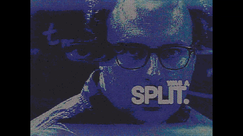
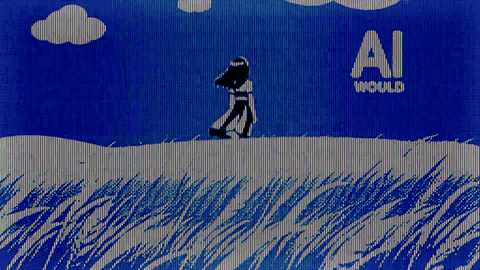
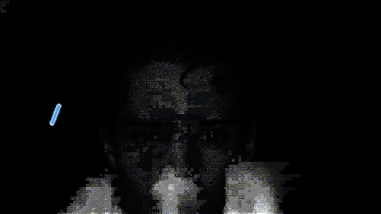
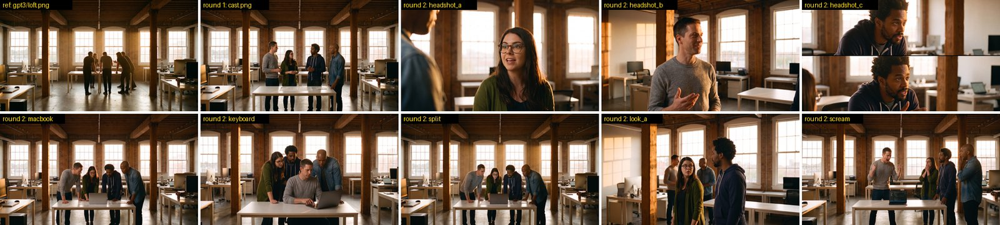
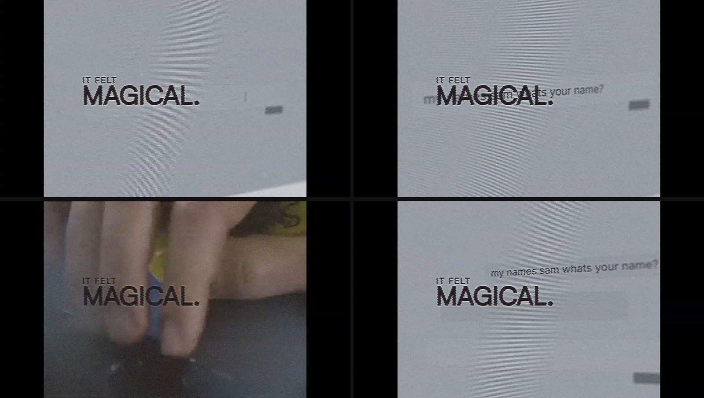
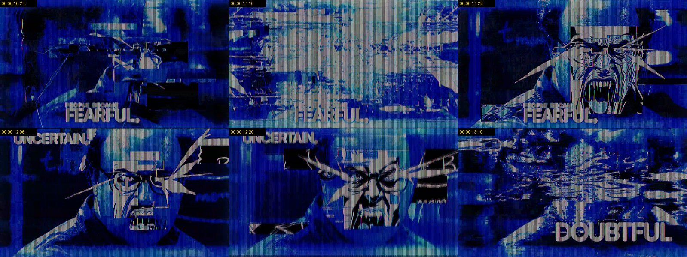
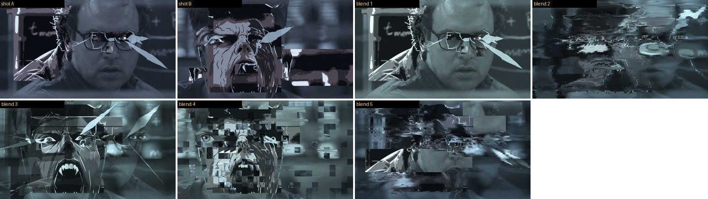
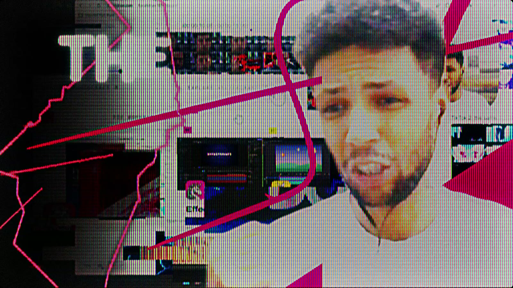

# Skills: how the launch film and the EffectCraft walkthrough were made

Each technique we built is its own skill. Each folder has:
- `SKILL.md`: the instructions an agent follows to do it again (scripts, settings, pitfalls)
- `README.md`: the write-up for people, with pictures of what it actually looks like
- `images/`: those pictures, all from this project

## Videos made with these

**Log, the launch film** (15 Nov 2026), [watch on X](https://x.com/matthewsoldit/status/2122065041843478886)

*0:09.6-0:16 of the film: the drop. The two men go cyberpsycho over 12 steps, glitch-cutting on the beat, with the
eye echo and lines, words in the negative space, a thermogram flash on the switch, all under the CRT.* Most of the
skills below were built for this film:
- the opener: [shot-camera-realism](shot-camera-realism/README.md), [grade-and-thermal-cuts](grade-and-thermal-cuts/README.md), [screen-ui-typing](screen-ui-typing/README.md)
- the drop: [cyberpsycho-cut](cyberpsycho-cut/README.md), [eye-echo](eye-echo/README.md)
- the cuts: [glitch-cut-transitions](glitch-cut-transitions/README.md), with effects from [numpy-fx-extraction](numpy-fx-extraction/README.md)
- the ending: the red lines from [seed-path-generators](seed-path-generators/README.md), the type from [crt-negative-space-type](crt-negative-space-type/README.md), then [end-card-and-outro](end-card-and-outro/README.md)
- all the stills: [locked-image-generations](locked-image-generations/README.md)
- the look over everything: [crt-vhs-look](crt-vhs-look/README.md)

**Log x Hermes Agent, the intro** (12 Nov 2026), [watch on X](https://x.com/matthewsoldit/status/2120938715820474690)

*0:03-0:10: the anime noir cut. Genre-swap match cuts and collage cut-ups of her, with words in the empty space,
under the CRT.* It's the earlier film (Intro 1). The CRT and thermal cuts in
[crt-vhs-look](crt-vhs-look/README.md) and [grade-and-thermal-cuts](grade-and-thermal-cuts/README.md) started here, the
locked style versions in [locked-image-generations](locked-image-generations/README.md) came from its genre swaps, and the
3D UI demos are [effectcraft-motion](effectcraft-motion/SKILL.md).

**/rea-looksmaxxing** (7 Nov 2026), [watch on X](https://x.com/matthewsoldit/status/2118876082409725989)

*0:00-0:07: neon handwritten type over halftone cut-outs, built on [treg](https://treg.to/?ref=matthewdonse-aebsh),
subquadratic and Log.* It came before these skills were written down.

The full videos are in `_showcase/src/` (mp4s stay local, not committed). The GIFs are cut from them with ffmpeg
(12 fps, 480 px, a 96-colour palette).

The process board ties them together: `textAnimations/PROCESS_BOARD.excalidraw`. To view it, open excalidraw.com, then menu > Open.

> **First time?** This project's image generation and hosting run through [treg](https://treg.to/?ref=matthewdonse-aebsh).
> Sign up with [this link](https://treg.to/?ref=matthewdonse-aebsh), install the CLI
> (`curl -fsSL https://treg.to/install.sh | sh`), run `treg login`, then check it with `treg balance`.
> Every skill below starts with the same steps.

## 0. Start here
| Skill | What it does |
|---|---|
| [new-video-project](new-video-project/README.md) | One command makes a new project: the folders, an EffectCraft project, matt's brief word for word, the rules from the launch film, a ready prompt for every stage, and the option to prime it from a past session's messages |

The skills are listed in the order they come up in a build: references, then pictures, then the shot, then cuts and type, then the ending, then editing and delivery.

## 1. References: reading the design out of what matt sends
| Skill | What it does |
|---|---|
| [numpy-fx-extraction](numpy-fx-extraction/README.md) | Reference edits broken into numbered frame sheets for matt to pick from, then the picked effects pulled out as transparent layers (chroma, streaks, noise, lines) |
| [seed-path-generators](seed-path-generators/README.md) | Lines from the references thinned into seeds, then generators drawing new ones every frame along paths and mattes (red cracks, slashes, red flash, ECG line) |

## 2. Pictures: generating and building what's on screen
| Skill | What it does |
|---|---|
| [locked-image-generations](locked-image-generations/README.md) | Nano Banana Pro stills generated in rounds so faces stay the same, with the camera locked across styles so they cut together |
| [screen-ui-typing](screen-ui-typing/README.md) | The ChatGPT/Playground screens built live in EffectCraft: the prompt typing in, filmed in 3D with depth of field in The Big Short's macro-monitor look, the mouse and key inserts |
| [cyberpsycho-cut](cyberpsycho-cut/README.md) | A person goes into the red sun_ae cyberpsycho look in 12 steps, cut off the background, glitch-cut on the beat |
| [eye-echo](eye-echo/README.md) | The eyes echoing outwards in different sizes, with cyberpsycho lines out of them |

## 3. The shot: camera, grade and screen look
| Skill | What it does |
|---|---|
| [shot-camera-realism](shot-camera-realism/README.md) | Handheld measured from The Big Short, push-ins, rack focus, one shot morphing into the next, the springing journey camera |
| [grade-and-thermal-cuts](grade-and-thermal-cuts/README.md) | Per-shot LUTs (sunny gold outside, Big Short cold inside) and the orange/green thermogram flashes on scene switches |
| [crt-vhs-look](crt-vhs-look/README.md) | The VHS look with 4:3 bars, then the CRT emulator; what goes under it, and switching its grade off where colour has to survive |
| [oled-screen](oled-screen/README.md) | Type on a lit OLED/LED screen filmed with a depth-of-field camera, then real 3D depth with every element its own layer (tried, then dropped from the film) |

## 4. Cuts and type
| Skill | What it does |
|---|---|
| [glitch-cut-transitions](glitch-cut-transitions/README.md) | Shot A past the cut, B early, double exposure, displacement, datamosh, pixel sort, under the CRT/VHS |
| [crt-negative-space-type](crt-negative-space-type/README.md) | Big words in the empty space under the CRT, 8-bit letter swaps, deep glow, flash cuts (the walkthrough's cold open and the launch captions) |

## 5. The ending and sound
| Skill | What it does |
|---|---|
| [end-card-and-outro](end-card-and-outro/README.md) | Nous, then Log wrapped in lines, then a glitch, then both side by side; the music's last phrase stuttered into a reverb tail; the sound-effect pass and what was kept |

## 6. Editing and delivery
| Skill | What it does |
|---|---|
| [filmcraft-talking-edit](filmcraft-talking-edit/README.md) | An hour-long recording cut to a 20-minute talking edit in FilmCraft: voice cleanup, pause cuts, J-cuts, close-ups, inserts, captions, a high-quality render for X |

## Older
| Skill | What it does |
|---|---|
| [effectcraft-motion](effectcraft-motion/SKILL.md) | Native EffectCraft product motion graphics (cards, 3D camera tours) |

