# CRT negative-space type

> **First time?** This project's image generation and hosting run through [treg](https://treg.to/?ref=matthewdonse-aebsh). Sign up with
> [this link](https://treg.to/?ref=matthewdonse-aebsh), install the CLI (`curl -fsSL https://treg.to/install.sh | sh`), run `treg login`,
> then check it with `treg balance`.

This is the 17.5-second cold open of the EffectCraft walkthrough, built in EffectCraft as editable layers. matt's
screen recording fills the frame behind a dark gradient on the left, and he is cut out on a layer above it. Big words
land as he says them, one or two at a time. They cut from one empty spot to another and never slide.

The rest of the look:
- Random letters flick into an 8-bit or gothic font.
- A deep glow sits on the type, and everything runs under a CRT.
- 2-frame word cards and flash cuts of his face hit on the words.
- Every cut has a transition.
- It ends on a riser and a quick white flash into the walkthrough.

The same idea first ran as the launch film's captions. There, the empty space was measured from each shot, and a card
went black when the space behind it was bright.

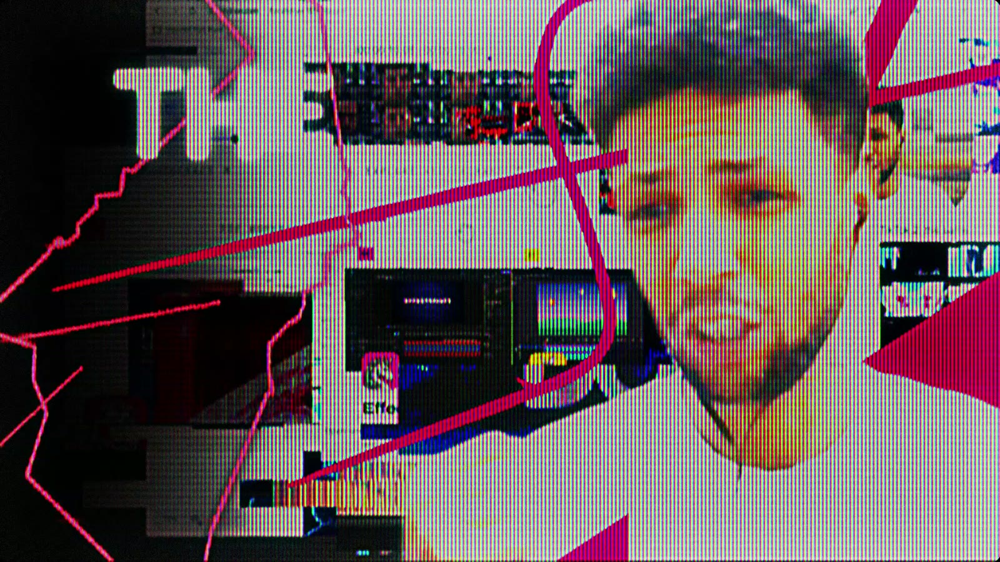
*1.50 s: "THE TIMELINE" goes up a chunk at a time on the left. matt is cut out on the right, with red lines looping
round him, and the CRT's scan lines run over everything.*

## How it works

### 1. The background: his screen, cut up

The plate is the FilmCraft edit's first 17.5 s with the camera track off (`intro_screen.mp4`). A numpy script cuts it
up every 2 frames: rectangles from other moments, inverted, channel-swapped or posterised, plus sliced rows. That
gives "the numpy thing as a background ... crazy distorted".

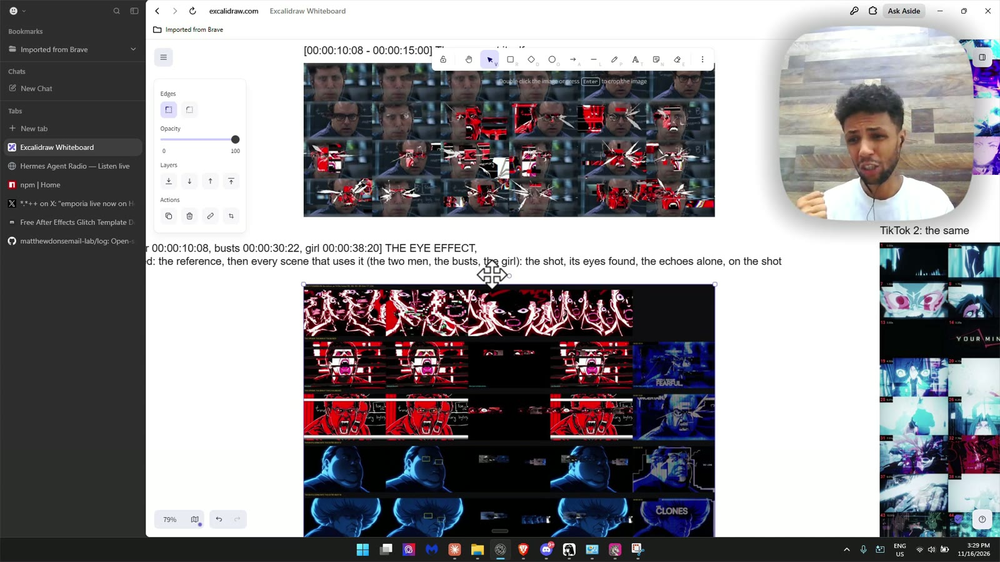
*The plate before the cut-up: matt's screen recording at 1.5 s.*

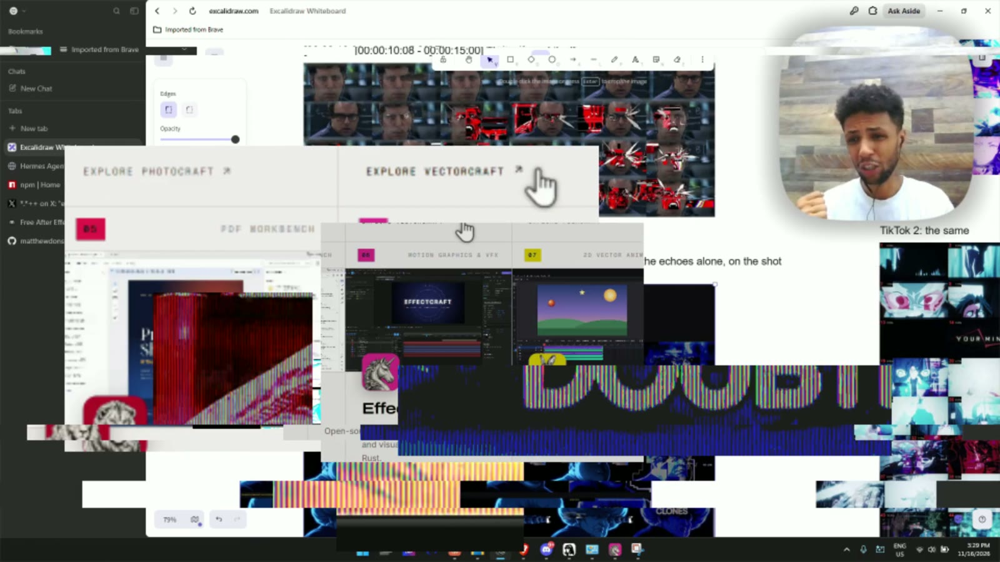
*`make_screen_collage.py`: the same frame with rectangles and slices from other frames pasted in.*

### 2. The dark gradient, and matt on his own layer

A black-to-clear gradient darkens the left half so the type reads there. matt is cut out of his webcam with rembg,
frame by frame, and sits above the gradient at 225% on the right.

*`left_gradient.png` shown over mid grey: black at the left edge, clear by the middle.*

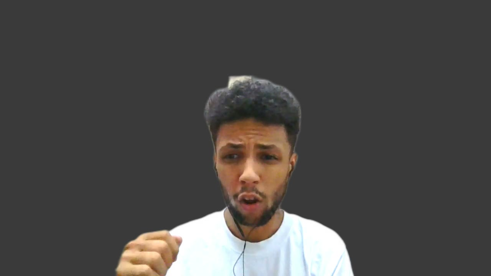
*One frame of `cutouts/beat_01/`: the rembg person matte, eroded and softened.*

### 3. Red lines round him

The launch film's red-line generator is redrawn every frame. Slashes loop round his matte and weave behind him in a
moving band. On every other card, cracks run down through the words.

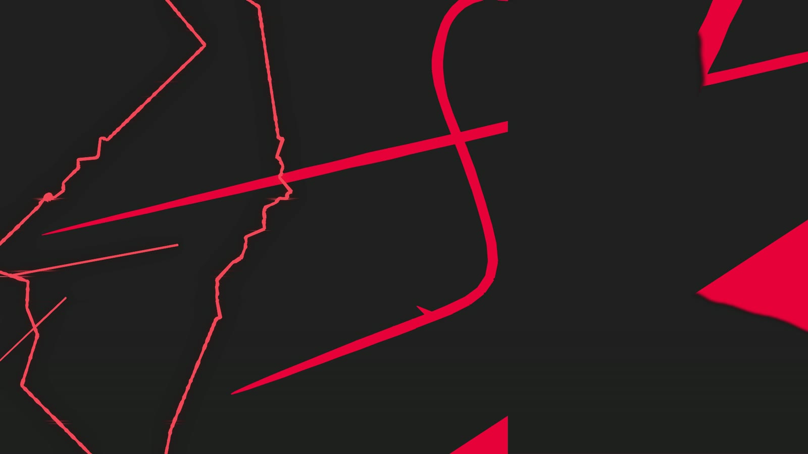
*One frame of `lines/` over dark grey.*

### 4. The type: big words, few at a time, letters swapping fonts

Each hook line goes up one or two words at a time, at size 240. Each chunk goes to the next of 8 spots round the frame.
Every 3 frames, about a third of the letters are redrawn in Press Start 2P (8-bit) or UnifrakturMaguntia (gothic),
sized to fit the Satoshi letter they replace. In EffectCraft each sequence gets its ink colour and three stacked glows
(a deep glow).

*One frame from `letters/card_5/`: "AND" with the A in 8-bit and the N in gothic, white on transparent before the ink.*

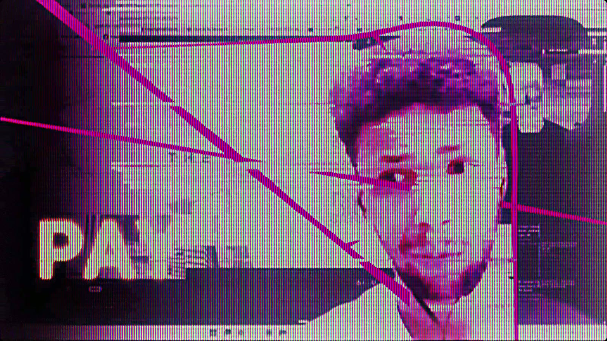
*10.03 s: "PAY" in the empty left side, matt on the right.*

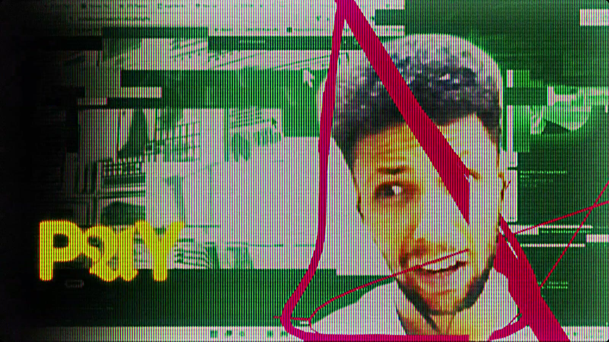
*10.67 s: the same line over the green thermograph look on the screen. The word cuts to a new spot; it doesn't slide.*

### 5. Word cards and flash cuts on the words

Between the words, 2-frame cards cut in, 49 in all. Each is a flat colour from the launch film's ending palette, with
the word big at a new spot, the whole line small in a corner, and UI elements in the card's ink. Flash cuts of matt,
zoomed on his face with the cyberpsycho eye glitch and masked on black, hit 3-4 frames inside the lines.

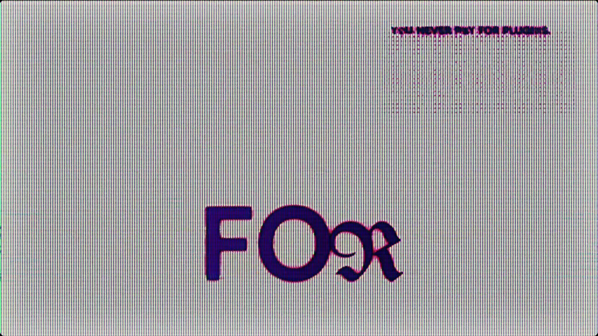
*10.73 s: a 2-frame word card. "FOR" in navy with a gothic R, "YOU NEVER PAY FOR PLUGINS." small top right, and a
dot grid.*

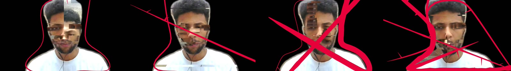
*`mattins/ins_03`: the 4 frames of one flash cut, pushing in, with the eye echoes and red slashes.*

### 6. Giant words with him inside the letters

On two lines a single word fills the frame and is used as a matte over live footage of him, drifting sideways with
red cracks for 7 frames.

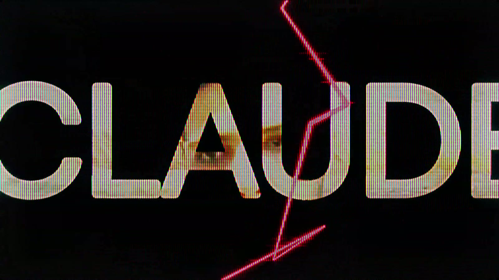
*4.33 s: "CLAUDE".*

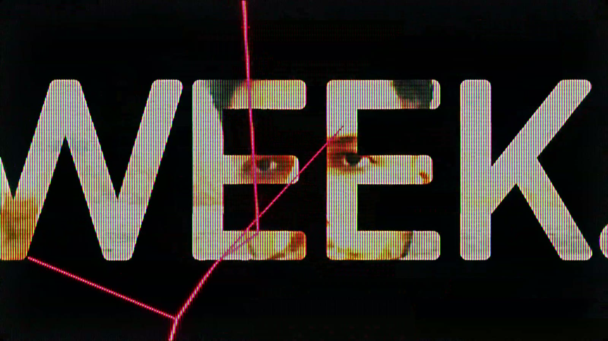
*13.33 s: "WEEK.", with his eyes showing through the letters.*

### 7. A transition on every cut

128 cuts, each with a transition. Most get the launch film's clip blend (a double exposure, displacement, cut-in
rectangles and echoes) with a pixel-sort burst on the cut. One gets the Edgerunners red flash. Each line change also
gets the thermogram: orange and green LUT frames inside an exposure blow-out.

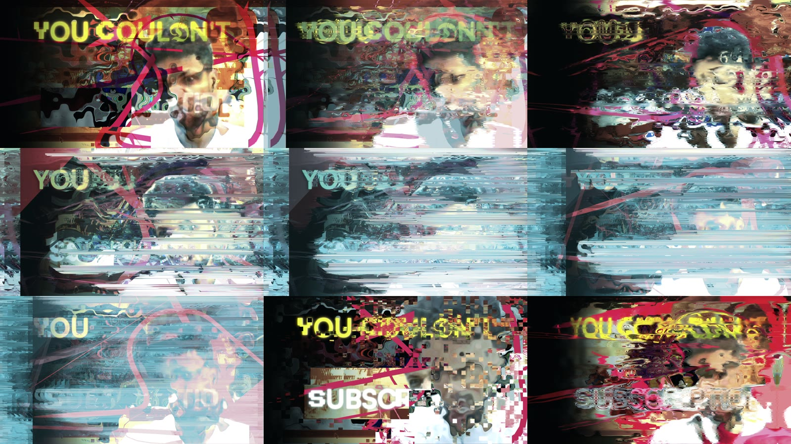
*`trans/cut_40`, the 9-frame blend on the cut into line 4 (frame 176).*

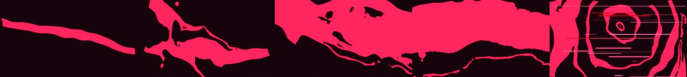
*`trans/cut_101`, the red flash over the cut into line 9 (frame 437).*

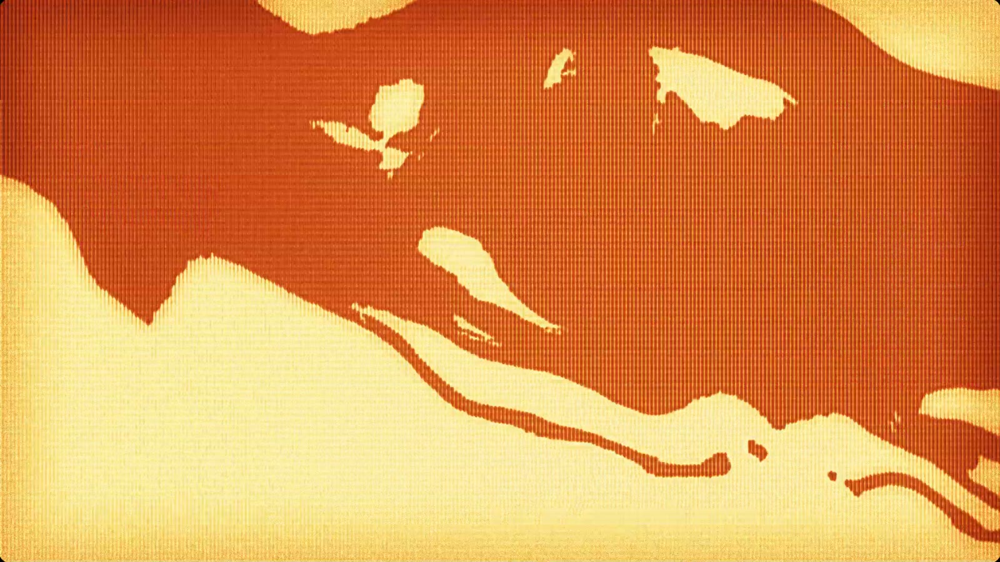
*14.57 s: the thermogram frame on the cut into "IT'S DONE IN 2 DAYS."*

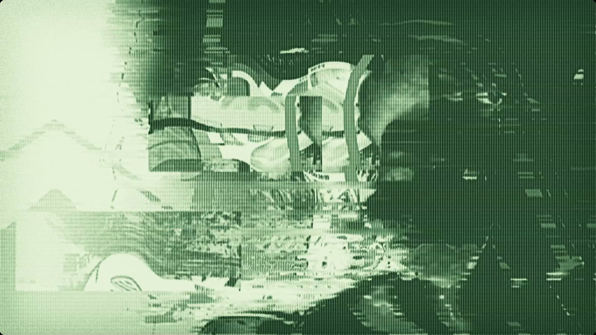
*16.00 s: a blend transition into the last line.*

### 8. The CRT on top, then out

The CRT-Emulator plug-in's own build (style 10) goes on top. Its colour grade is switched off so the reds survive, and
the scan lines are at 70%. In FilmCraft a riser builds under the last 10 seconds and peaks on the drop at 17.38 s. A
6-frame white flash dissolves into the walkthrough.

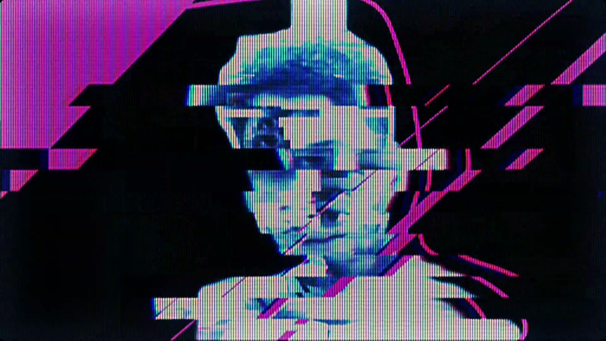
*17.33 s: the last frames of "THIS IS THE GREATEST UPGRADE WE'LL EVER HAVE." before the flash.*

## The earlier version: the launch film's captions

For the launch film, every word of the voiceover went on screen 1-3 words at a time. Each card was placed by
measuring the film itself: the least busy spot in the shot, never where the last card was. The key word was huge and
the small words sat above and below it. The card went black when the empty space behind it was brighter than 45% grey.

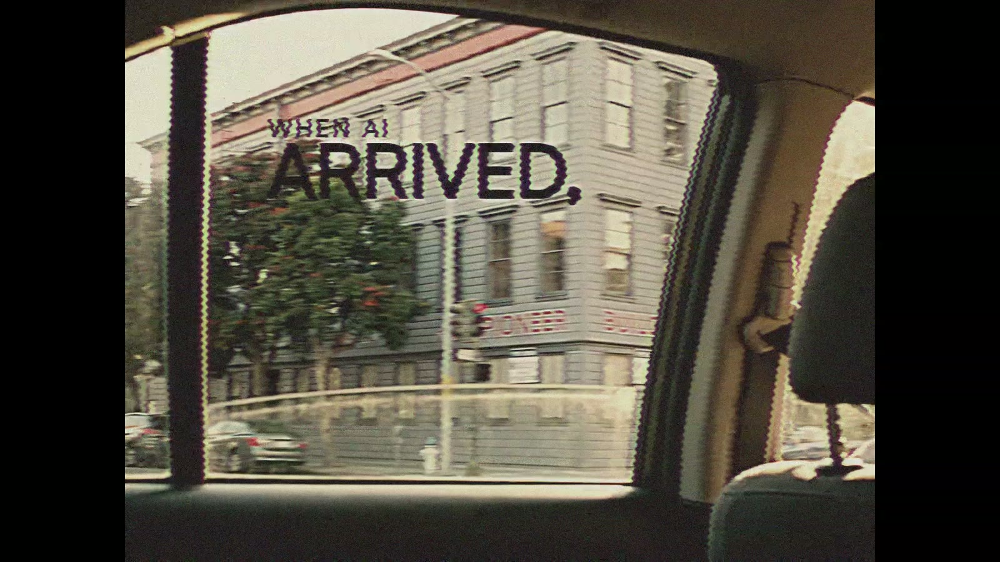
*Launch film 1.2 s: "WHEN AI ARRIVED," in black, because the empty space is bright.*

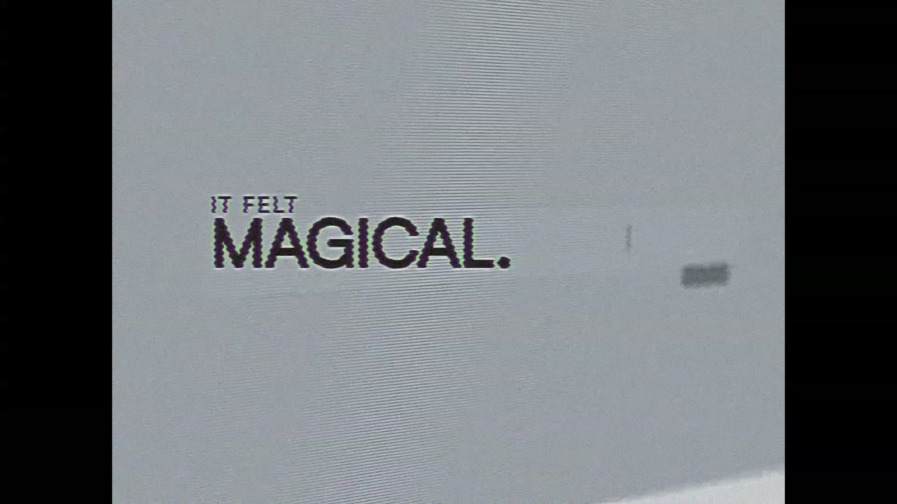
*3.0 s: "IT FELT MAGICAL." in black on the light grey shot.*

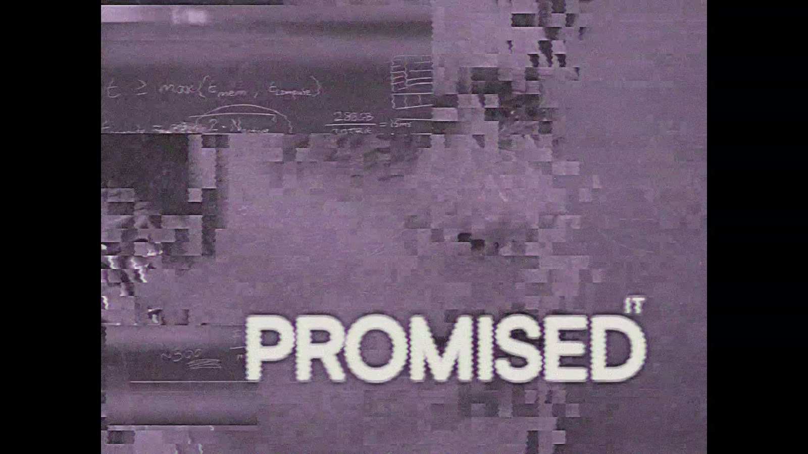
*5.0 s: "IT PROMISED US" in white with a glow, at the bottom right where the shot is darker.*

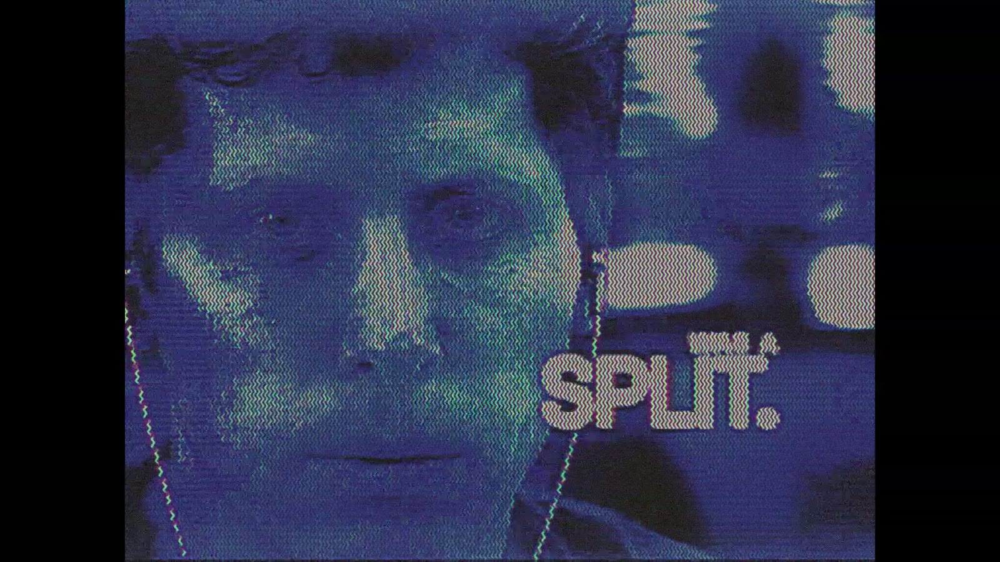
*9.0 s: "WAS A SPLIT." in the dark space beside the face.*

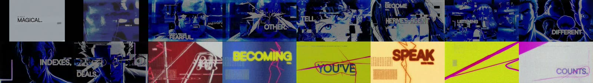
*`introEC/intercuts_sheet.jpg`: 16 frames from the launch film. Each caption sits in a different empty space, under
the CRT and the thermal looks.*

## The result

- `introEC/intro_render.mp4`: 1920x1080, 30 fps, 17.5 s. It plays at 0:00-0:17.5 of the walkthrough
  (`renders/effectcraftEditing-20min-v15-hq.mp4`).
- The 10 lines start at 0.00, 2.27, 2.77, 5.87, 7.37, 9.67, 11.47, 11.70, 14.57 and 16.03 s.
- The white flash is at 17.47-17.57 s, and the walkthrough's voice starts at 17.38 s.

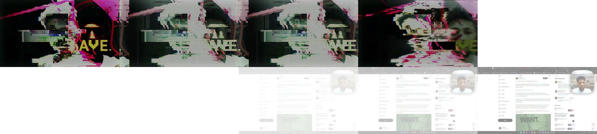
*10 frames from 17.40 s in the final walkthrough: the last glitch frames, the white flash, then the screen fading back.*

## The files

All in `C:/Users/0/filmcraft/projects/effectcraftEditing/introEC/` unless shown otherwise.

| File | Job |
|---|---|
| `introEC.ecproj` | The EffectCraft project, comp `intro` |
| `intro_base.jsx` | Builds the comp: plate, gradient, 10 line cards |
| `intro_fx.jsx` | Red lines layer, thermal screen looks, cut displace, the thermogram on line changes |
| `applyIntroCRT.jsx`, `CRTemulator/` | The CRT-Emulator build (style 10) and matt's fixes to it |
| `make_face_cutouts.py`, `intro_cutout.jsx` | matt cut out with rembg, one layer per line |
| `intro_face.jsx` | The earlier full-frame face shots (replaced by the cutouts) |
| `make_intro_lines.py` | The red slashes and cracks, per frame |
| `intro_words.jsx` | Words land as he says them (`beats.json`) |
| `intro_glitch.jsx` | The background tear on every word |
| `intro_flashcards.jsx` | The 2-frame word cards |
| `make_intro_transitions.py`, `intro_trans.jsx` | The blend and red-flash transitions on every cut (`all_cuts.json`, `clean/`) |
| `make_intro_inserts.py`, `intro_crazy.jsx` | The flash cuts of him, the giant words and the UI on the word cards |
| `make_screen_collage.py` | The cut-up background |
| `intro_left_glitch.jsx` | The type back on the left, and the text glitch |
| `intro_fonts_glow.jsx` | The first font swap (whole layers) and the deep glow |
| `make_letter_text.py`, `intro_letters.jsx` | The final type: 1-2 word chunks round the screen, letters swapping fonts |
| `../build_v11.py`, `../build_v12.py`, `../build_v15_layers.py` | Put the intro, the riser and the white flash into the FilmCraft edit |
| `listeningkit-templates/textAnimations/assets/make_launch_captions.py` | The launch-film captions in measured negative space |
| `listeningkit-templates/textAnimations/plugins/launchCaptions.jsx` | Its generated EffectCraft script |
| `listeningkit-templates/textAnimations/plugins/caption_layouts.py` | Intro 1's hand-placed caption layouts |

## Assets

Everything this skill needs to run again (scripts, plugins, LUTs, seeds, sprites, data) is copied into
[`assets/`](assets/MANIFEST.md) at the same paths it has in the repo. The manifest lists what's bundled, what's shared with
another skill, and which big media (renders, projects, reference videos) stays in the repo.
