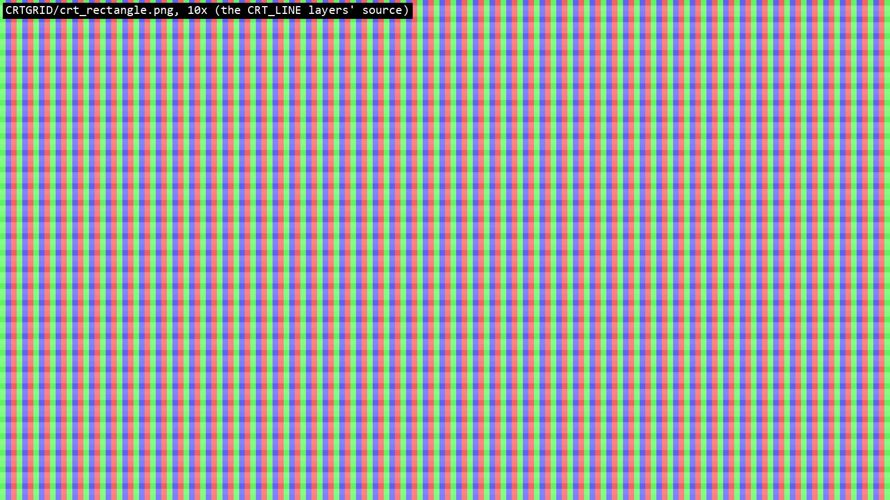
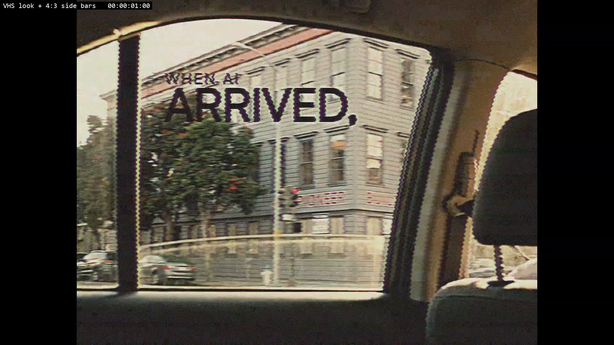
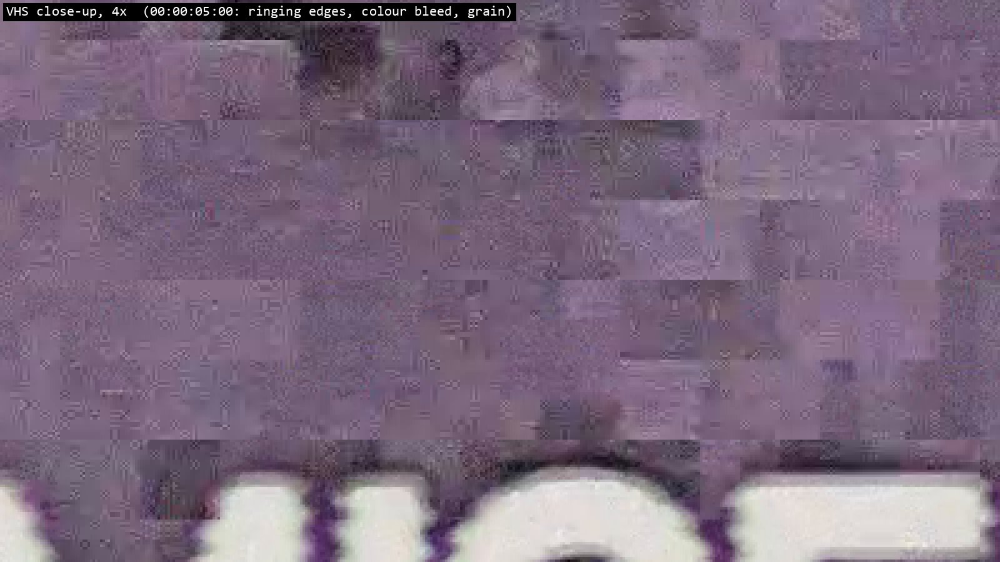
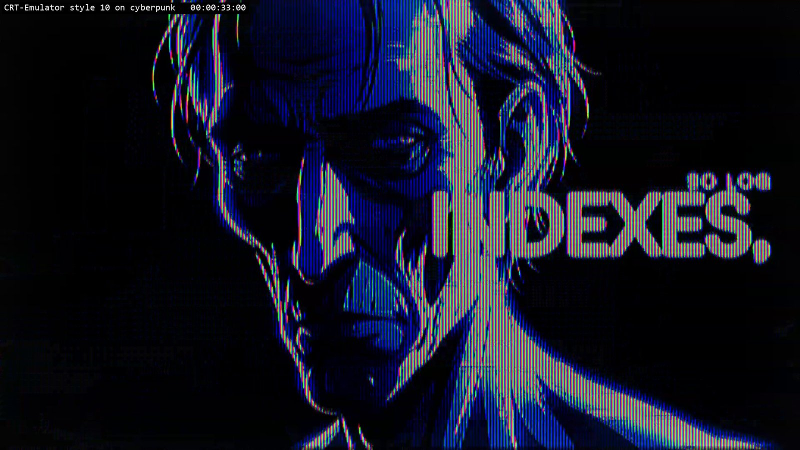
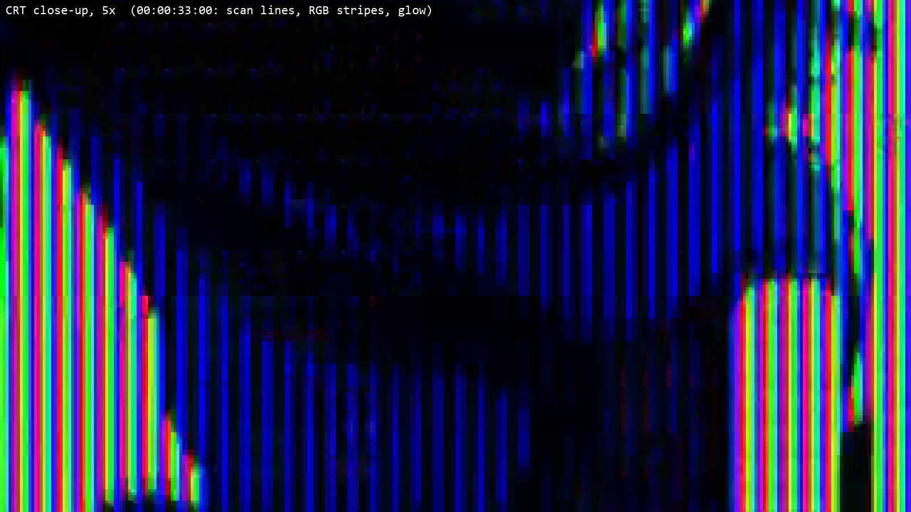
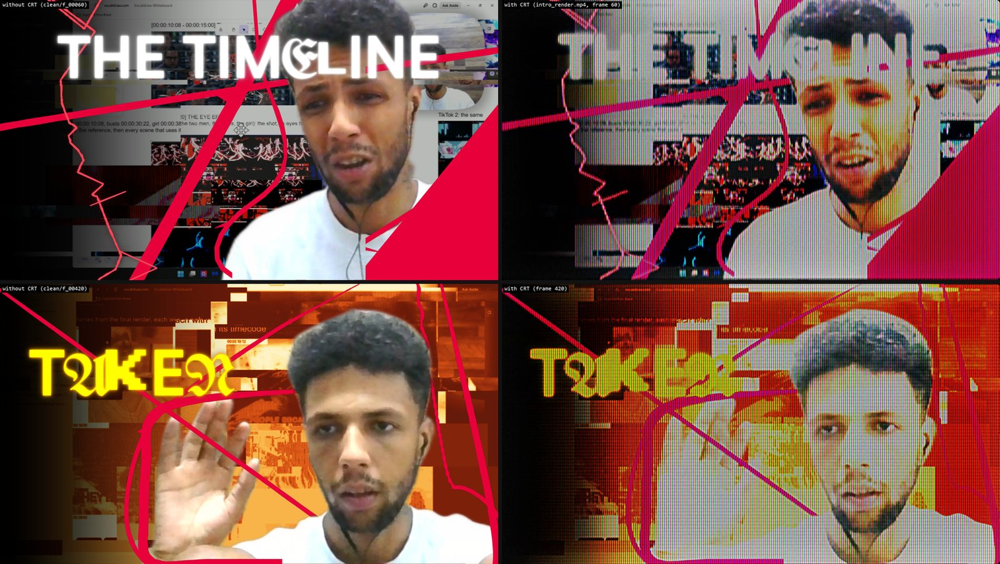
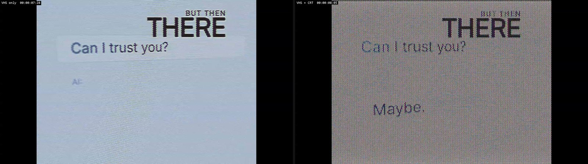
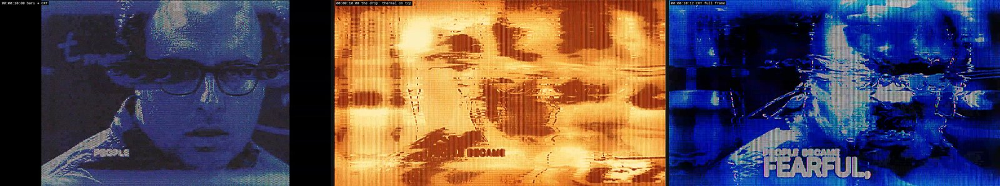
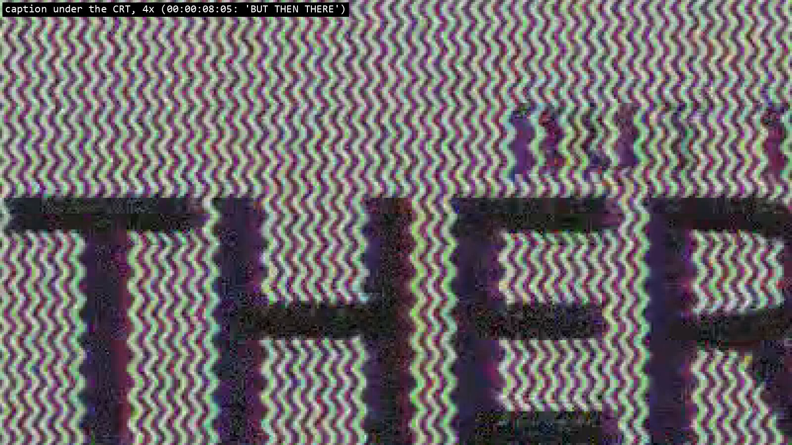
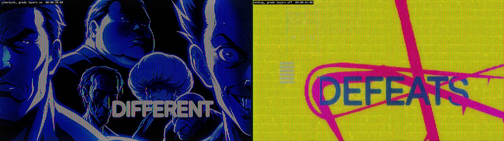

# CRT and VHS look

> **First time?** This project's image generation and hosting run through [treg](https://treg.to/?ref=matthewdonse-aebsh). Sign up with
> [this link](https://treg.to/?ref=matthewdonse-aebsh), install the CLI (`curl -fsSL https://treg.to/install.sh | sh`), run `treg login`,
> then check it with `treg balance`.

## What it is

The launch film looks like it's playing on old screens. Up to the beat drop, the opener is a washed-out VHS tape in a
4:3 picture with black bars down the sides. From the drop to the end, a CRT monitor runs over everything: RGB stripes,
scan lines, a flickering blue glow, a slight wobble and a blue-grey colorize. The same CRT runs over Intro 1 and the
EffectCraft walkthrough intro.

None of it is baked. The VHS look is one adjustment layer of stock effects. The CRT is the CRT-Emulator plug-in's own
build (style 10), applied in EffectCraft by calling the plug-in's Apply function from a script. Both stay editable
layers in the comp, on top of the picture, the captions and the transitions.

## The reference

- VHS: the tragedy_rx edit (`projects/opening/ref/tragedy_rx`), as the `applyOpening.jsx` comment describes it: lifted
  milky blacks, dull whites, less colour, a warm cast, a soft image sharpened back hard so every edge rings, red and blue
  bleeding sideways, a little line wobble, grain.
- CRT: the CRT-Emulator After Effects plug-in, style 10, run unchanged (`textAnimations/plugins/CRTemulator/`).

*The plug-in's `CRTGRID/crt_rectangle.png` at 10x: the RGB stripe grid the two `CRT_LINE` layers are made from (one in
Darken, one in Overlay with a wiggling displacement).*

## How it works

### Step 1: the VHS look and the bars (the opener, 0 to 00:00:10:08)

`applyOpening.jsx` adds one adjustment layer, `VHS look`: a sideways Gaussian blur (3), Unsharp Mask sharpening it back
hard (180, radius 4) so edges ring, Channel Blur on red (9) and blue (12) sideways for colour bleed, a small Wave Warp,
Levels lifting the blacks to 0.11 and pulling the whites to 0.88, saturation -22, a warm Tint at 18%, and grain. Then
two black solids 240 px wide down the sides make the picture 1440x1080, a 4:3 frame inside the 16:9 one.

*The opener's first card at 00:00:01:00 ("WHEN AI ARRIVED,"): warm, washed out, 4:3 between the bars.*

*4x into 00:00:05:00 ("PROMISED"): the ringing round the letters, the colour bleed and the grain.*

### Step 2: the CRT build

The plug-in's ExtendScript (`jsx/crtEmulator.jsx`) is included as it is. Its panel doesn't run in EffectCraft, so the
apply script calls `applyClick(dir, "10")`, the function behind the panel's Apply button, with one layer selected. A
small shim maps the After Effects effect indices the plug-in uses to EffectCraft's parameter names. Style 10 adds 17
layers: the stripe grid twice, a displacement flicker, channel blur, sharpen, grain, two glows (one flickering), a
wave-warp distortion and `CC 2`, which colorizes everything blue (hue 230). Posterize Time is switched off everywhere.

*Cyberpunk at 00:00:33:00 ("INDEXES,") with the full CRT: blue-grey, glowing, striped.*

*5x into the same frame: the vertical RGB stripes, the scan lines and the glow bleeding off the bright edges.*

*The walkthrough intro rendered without the CRT (`introEC/clean/`, used to build its transitions) and with it
(`introEC/intro_render.mp4`), frames 60 and 420. Here the grade layers are off, so the reds and yellows stay; the CRT
adds the stripes, the glow and the softness. (The clean frames are from an earlier pass of the same edit.)*

### Step 3: from VHS to CRT

In the opener the VHS look and the bars run to the drop. The script starts the CRT on the drop (00:00:10:08), where a
thermogram flash (orange and green LUTs inside an exposure blow-out) sits on top of everything. In the film as saved, the
CRT starts earlier, at 00:00:08:01, over the VHS and the bars.

*The "Can I trust you?" chat: VHS only at 00:00:07:28, and the same shot at 00:00:08:05 once the CRT is on.*

*00:00:10:00 bars plus CRT; 00:00:10:08 the drop, the thermogram flash over everything; 00:00:10:12 full-frame CRT.*

### Step 4: what goes under it

matt insisted that the captions, the transitions and the glitches go under the CRT and VHS, so the look runs over them
too. Every script that adds those finds the lowest look layer in the comp and slots in just under it. Only the
thermogram flash goes over the CRT.

*4x into 00:00:08:05: the "BUT THEN THERE" caption is under the CRT, so the stripes run through the letters.*

From the top of a section comp down:

| Layer | Where |
| --- | --- |
| `thermal green`, `thermal orange`, `exposure cuts` | over everything, the CRT included |
| `bar left`, `bar right`, `VHS look` | opener only, 0 to the drop |
| the CRT stack (`Global Scale` ... `CRT ExposureFIX`) | the look |
| `cap ...` captions | under the look |
| `cutfx ...`, `cutblend ...`, `end trans ...`, `text glitch`, inserts | under the captions and the look, above the picture |
| the picture (shots, pre-comps) | bottom |

### Step 5: letting colour through

`CC 2` and the other colour layers turn everything blue-grey and kill yellow and red. In the ending, where the cards cut
between acid yellow, red, navy and black, five layers are switched off: `CC`, `CC 2`, `CRT ExposureFIX`, `CRT Glow`,
`Glow`. The stripes, flicker and distortions stay. The walkthrough intro does the same but keeps `CRT ExposureFIX` on
(without it the scan lines wash everything lavender), sets the stripe layers to 70% and takes the plate down a stop.

*Cyberpunk at 00:00:30:00 with the grade on, and the ending at 00:00:42:00 ("DEFEATS") with it off: same CRT stripes,
the yellow and magenta survive.*

In Intro 1 the end card logos go just above `CC 2` instead: above the colorize, so they keep their true colours, still
under the grid and the glow. During its UI shots the stripes drop to 45% and Posterize Time to 0 so the text reads.

## In the film

`textAnimations/renders/launch_film_final_full.mp4` (65.4 s, 30 fps):

| Timecode | Look |
| --- | --- |
| 00:00:00:00 - 00:00:08:01 | VHS look, 4:3 side bars |
| 00:00:08:01 - 00:00:10:08 | VHS and bars with the CRT over them (as saved; the script starts the CRT at 10:08) |
| 00:00:10:08 | the drop: thermogram flash over everything |
| 00:00:10:08 - 00:00:37:13 | full CRT, blue-grey grade (opener after the drop, then cyberpunk from 00:00:15:00) |
| 00:00:37:13 - 00:01:05:12 | the ending and the end card: CRT with the grade layers off |

## The files

| File | What |
| --- | --- |
| `textAnimations/plugins/CRTemulator/applyOpening.jsx` | VHS look, side bars, CRT from the drop, in `opening` |
| `textAnimations/plugins/CRTemulator/applyCyberpunk.jsx` | CRT on `cyberpunk`, thermogram back on top |
| `textAnimations/plugins/CRTemulator/applyIntro1.jsx` | CRT on `Intro 1`, softer on the UI shots |
| `textAnimations/plugins/CRTemulator/hideCyberpunkCRT.jsx` | CRT off on `cyberpunk` for previews |
| `textAnimations/plugins/CRTemulator/jsx/crtEmulator.jsx` | the plug-in's ExtendScript, unchanged |
| `textAnimations/plugins/CRTemulator/CRTGRID/` | the plug-in's grid, circle and displacement assets |
| `textAnimations/plugins/endingType.jsx`, `endingCards.jsx` | CRT on `ending`, grade layers off |
| `textAnimations/plugins/launchCaptions.jsx` (from `assets/make_launch_captions.py`) | captions placed under the look |
| `textAnimations/plugins/launchSectionCuts.jsx` (from `assets/make_section_cuts.py`) | cut blends and glitches under the look |
| `textAnimations/plugins/openingThermal.jsx`, `thermalCuts.jsx` | thermogram flashes over the CRT |
| `textAnimations/OPENING.md` | the opener's run order and look |
| `C:/Users/0/filmcraft/projects/effectcraftEditing/introEC/applyIntroCRT.jsx` | CRT on the walkthrough intro, grade off, ExposureFIX on |

## Assets

Everything this skill needs to run again (scripts, plugins, LUTs, seeds, sprites, data) is copied into
[`assets/`](assets/MANIFEST.md) at the same paths it has in the repo. The manifest lists what's bundled, what's shared with
another skill, and which big media (renders, projects, reference videos) stays in the repo.
