# FilmCraft talking edit

> **First time?** This project's image generation and hosting run through [treg](https://treg.to/?ref=matthewdonse-aebsh). Sign up with
> [this link](https://treg.to/?ref=matthewdonse-aebsh), install the CLI (`curl -fsSL https://treg.to/install.sh | sh`), run `treg login`,
> then check it with `treg balance`.

This is how a 67.5-minute screen recording of matt explaining EffectCraft became a 20:54 talking-head walkthrough in
FilmCraft. The edit was built from scripts and the FilmCraft CLI, not by hand on the timeline.

The transcript is the cut list, and sentences stay whole. The voice is cleaned with NVIDIA RE-USE. Real pauses are
found in the cleaned voice and cut out. Every cut is a J-cut: the voice comes in 8+ frames before the picture. Whole
talking sentences go to a bust-shot close-up. When the cut changes, the cutaways (the launch film, the actual Big Short
opening and 23 breakdown inserts) are re-placed by mapping their times through the old and new edit decision lists
(EDLs). The final file goes out as ProRes pieces re-encoded with x264, because FilmCraft's own H.264 export came out
blocky.

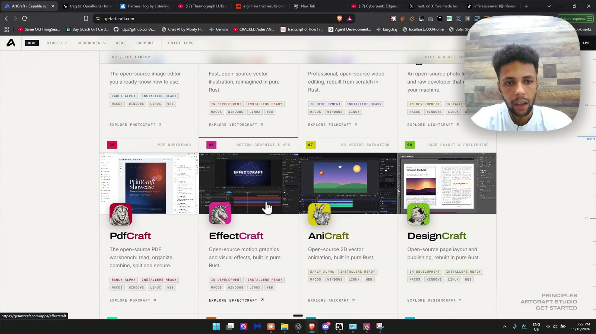
*0:30: the body of the walkthrough. matt's screen recording, his own webcam bubble from Cap, and no burned-in captions
(they're a separate SRT).*

## How it works

### 1. Transcript and voice

AssemblyAI transcribes the raw laptop mic word by word. The mic is quiet and noisy, so the voice goes through NVIDIA's
RE-USE speech model on a Colab T4. Colab was needed because the model needs CUDA. The voice went up in three parts of
20.5, 24.8 and 22.2 minutes. matt said Adobe Enhance caps files at 30 minutes.

RE-USE alone was "a bit too strict" and dropped some speech. So the original is patched back in at the 750 spots
where RE-USE went quiet (146 s in all), with 15% of the original left under the rest.

### 2. The transcript is the cut list

Every sentence is numbered (`sentences.txt`). The 20-minute cut keeps a set of sentence numbers (`KEEP_20`) with the
visual demos as the spine. False starts are cut word for word. A cold open of 10 one-liners plays first, then the
body runs in the recording's order.

### 3. Cut the pauses, keep the sentences

Wherever the cleaned voice stays under -45 dBFS for 0.30 s or more between two words, the edit cuts and both words'
edges move onto the silence. Before this change, 20min-v10 had 179 pauses of 0.25 s or more left in.

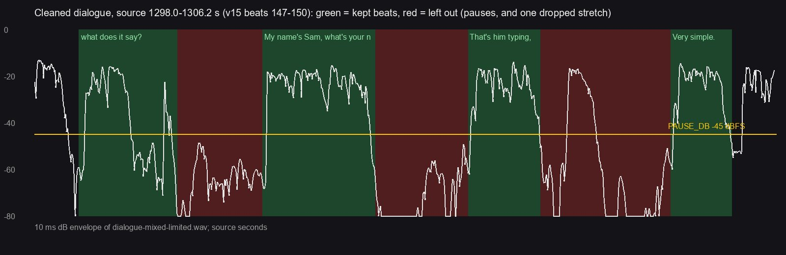
*Source 21:38-21:46: four kept beats (green, v15 beats 147-150). The quiet gaps between them, under the yellow
-45 dBFS line, are left out (red). In the edit these beats play at 6:20.0-6:23.6.*

### 4. J-cuts

Dialogue clips rotate over four audio tracks, so each new line can start over the tail of the last one. On every body
cut, the picture comes in at least 8 frames (at 60 fps) after the voice. The outgoing picture holds over that gap.

### 5. Close-ups

The webcam goes full frame on every curse, joke and number, and on whole talking stretches, 121 times in v15. It's
framed as a shoulder-up bust shot: Fill Frame, then 225% at position 1052,270, with his face centred.

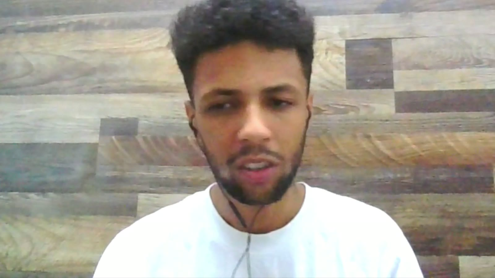
*1:45.5: the bust-shot close-up on "And if anyone says it doesn't look good, they're lying."*

### 6. Cutaways and breakdown inserts

When he talks about the launch film, the film itself cuts in. When he talks about The Big Short, the actual opening
plays. When he talks about how something was made, a full-screen breakdown cuts in. The breakdowns are process-board
pictures and reference videos, fitted, or panned across when they're wide or tall.

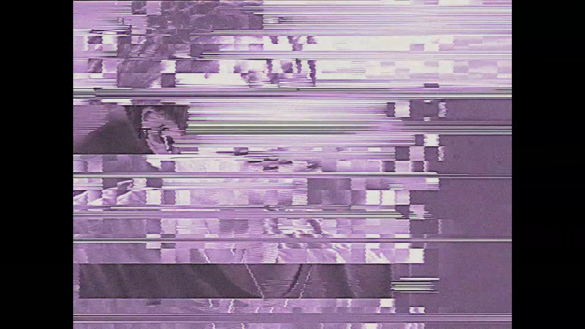
*3:14: the launch film's opener (3:11.9-3:16.2), cut in as he leads up to "the opening shot of The Big Short".*

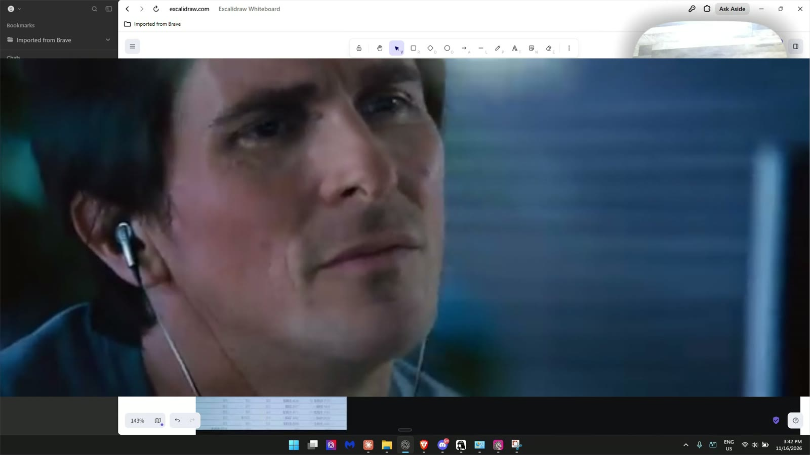
*3:25: The Big Short's opening (3:16-3:42 in the edit), under "It closes in on the shots to show the numbers". It's
`styleref.mp4` at 300%, and the source capture's player bar still shows at the bottom.*

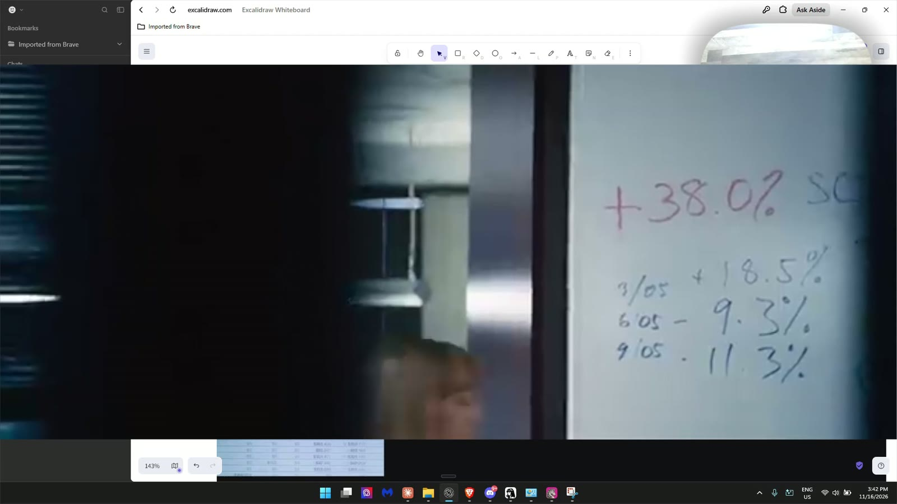
*3:35: further into the same insert.*

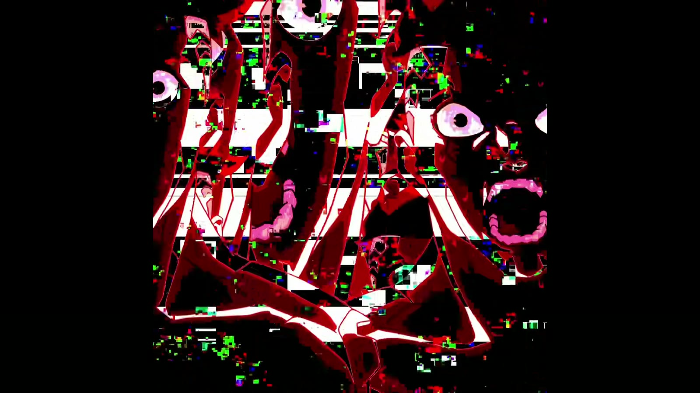
*10:00.5: breakdown insert `bd_09`, the sun_ae TikTok, under "this TikTok, the sun_ae one".*

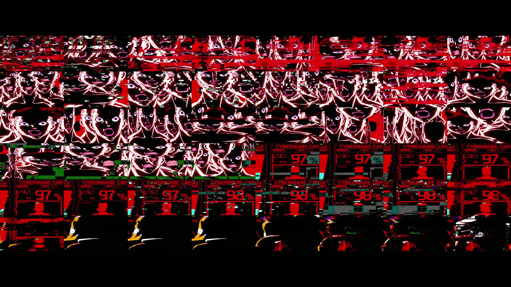
*10:03: `bd_10`, the picked sun_ae frames sheet.*

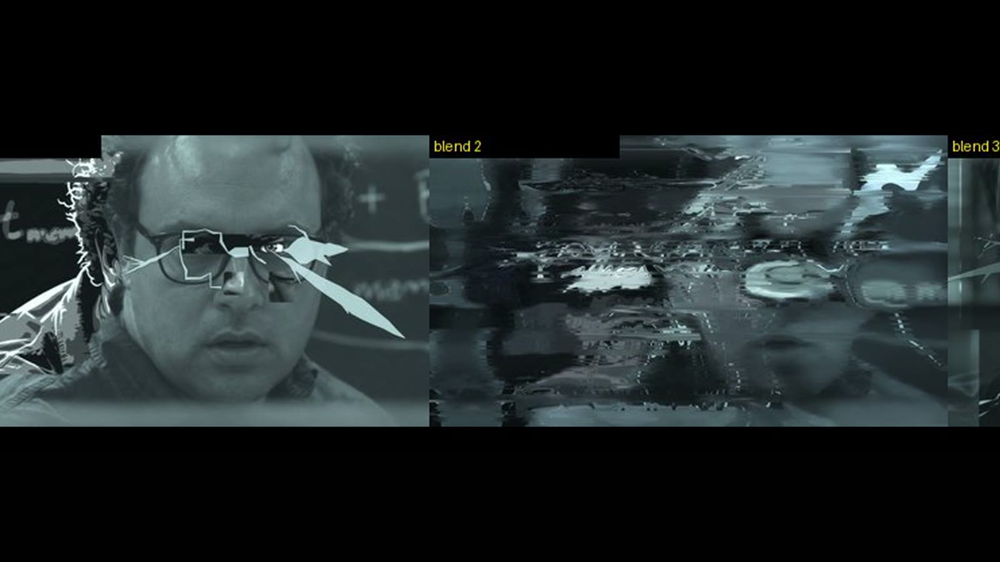
*15:37: `bd_19`, the transition how-to strip panning left to right, under "shot A runs past the cut, shot B starts
early".*

These cutaways were placed against an older cut (v10). When v15 re-cut the pauses, every insert time went through the
v10 EDL back to the recording's own time, then through the v15 EDL to its new place. That keeps each insert on the
words it belongs to.

### 7. Intro, captions and the end

The EffectCraft cold open (the crt-negative-space-type skill) sits on top for the first 17.5 s. A riser builds under
it, and a 6-frame white flash dissolves into the body. Captions come from the transcript as an SRT, up to 8 words per
cue, left-aligned at the bottom, with the intro's cues removed.

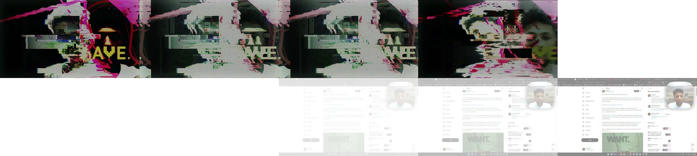
*10 frames from 17.40 s: the last intro frames, the white flash, then the screen fading up.*

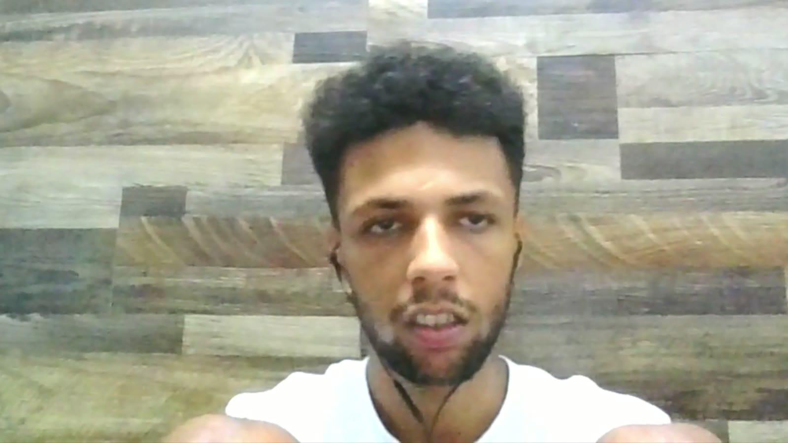
*20:52: the close, full face.*

### 8. Rendering it sharp

FilmCraft's own H.264 export came out at about 2 Mbps and blocky. The fix (`render_hq.sh`) has four steps:
1. Export the picture from FilmCraft as ProRes LT in 4 pieces.
2. Encode each piece with x264 CRF 16.
3. Join the pieces.
4. Add the FilmCraft audio mix as AAC 320k with `+faststart`.

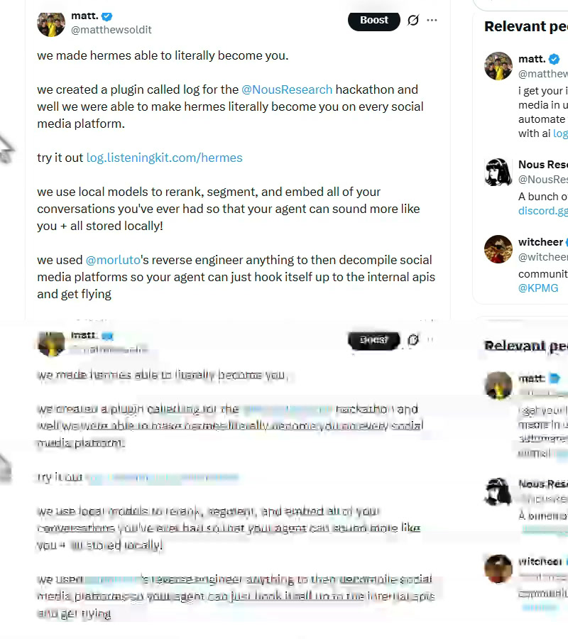
*`renders/sharp_vs_your_render_crop.png`, at 0:20: the sharp frame (top) and FilmCraft's own H.264 export of the same
frame (bottom), with the text broken into blocks.*

## The result

- `renders/effectcraftEditing-20min-v15-hq.mp4`: 1920x1080, 60 fps, 20:54 (1254.07 s), H.264 at about 9.5 Mbps
  plus AAC (9.8 Mbps in total), 1.54 GB. Captions are in `renders/effectcraftEditing-20min-v15-hq.srt`.
- 594 beats from 4050.66 s of source. 121 camera close-ups. 38 clips on V4: the white flash, 13 launch-film cutaways,
  The Big Short and 23 breakdowns.
- Timecodes:
  - 0:00-0:17.5: the intro.
  - 2:55-3:08: the first breakdowns (reference material).
  - 3:11.9-3:16.2: the launch film's opener.
  - 3:16.2-3:42.3: The Big Short.
  - 10:00-10:05: the sun_ae breakdowns.
  - 15:28-15:41: the transition breakdowns.
  - 19:38-19:43: the last launch-film cutaway.
- Posting to X: X Premium allows up to 16 GB. Upload from the web or an iPhone, because the Android app caps video at
  10 minutes.

## The files

All in `C:/Users/0/filmcraft/projects/effectcraftEditing/` unless shown otherwise.

| File | Job |
|---|---|
| `transcribe.py`, `transcriptMic.json`, `sentences.txt` | The AssemblyAI transcript and the numbered sentences |
| `enhance/colab_job.py`, `colab_start.py`, `colab_run_all.sh`, `run_reuse_colab.py` | RE-USE on a Colab T4, three parts |
| `mix_dialogue.py`, `mix_report.txt`, `prep_dialogue.sh` | Patch RE-USE's dropouts with the original; levelling |
| `_parts.py` | This recording's cut list: hook, `KEEP_20`, cut phrases, quick lines, fixes, close-ups, `PAUSE_SPLIT_S`, `NO_SPLIT_AFTER` |
| `_generic.py`, `_assemble.py` | Template and assembler that write `edit_config.py` |
| `make_build.py` | Writes `build_edit.py` from `../databroker/build_edit.py`, adding `silent_split`, J-cuts and the bust framing |
| `build_edit.py` | Builds the base cut: EDL, review, SRT, camera list, `.fcproj` |
| `face_box.py` | Where his face sits in the webcam, for the bust framing |
| `build_v11.py` ... `build_v14.py` | The layers as first added on the v10 timing |
| `build_v15_layers.py` | Puts all the layers on the v15 cut through the EDLs |
| `make_breakdown_inserts.py`, `breakdowns/` | The 23 breakdown inserts |
| `render_hq.sh` | The high-quality render |
| `effectcraftEditing-review-20min-v15.md`, `effectcraftEditing-edl-20min-v15.json` | Every beat of v15, readable and as data |
| `EDITING_FUNDAMENTALS.md`, `NOTES-v1.md` | What the video says, and the v1 notes to matt |
| `C:/Users/0/filmcraft/projects/databroker/build_edit.py` | The base pipeline it all comes from |

## Assets

Everything this skill needs to run again (scripts, plugins, LUTs, seeds, sprites, data) is copied into
[`assets/`](assets/MANIFEST.md) at the same paths it has in the repo. The manifest lists what's bundled, what's shared with
another skill, and which big media (renders, projects, reference videos) stays in the repo.
