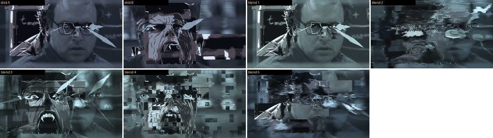
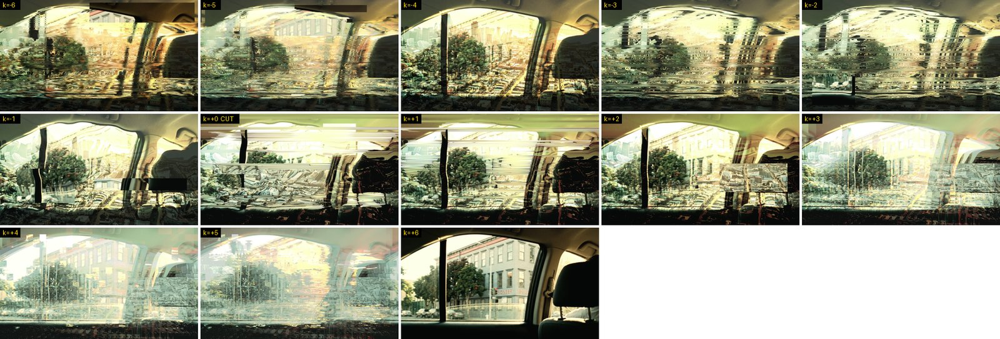
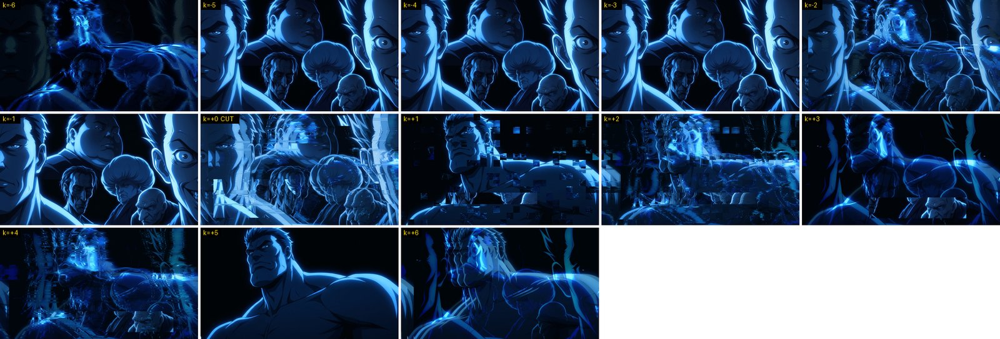
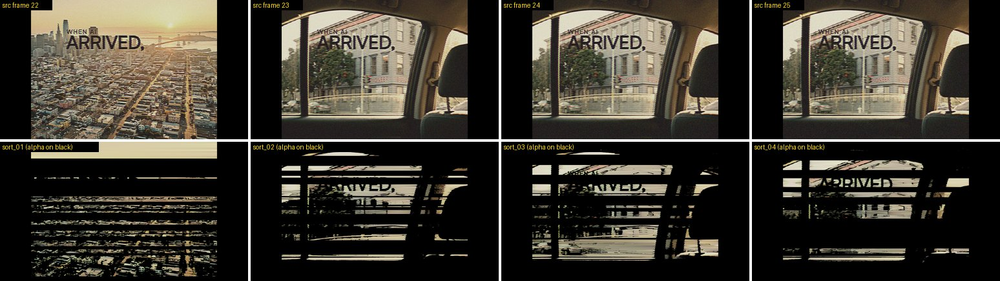
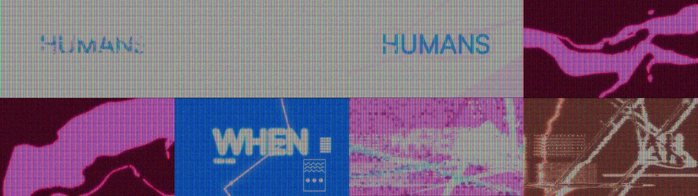
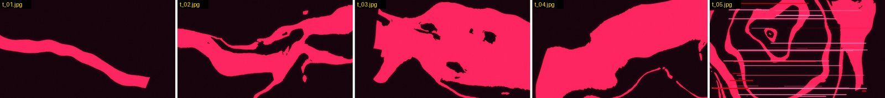
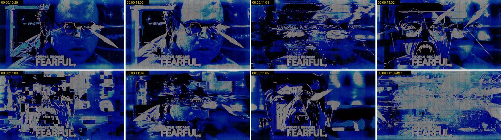
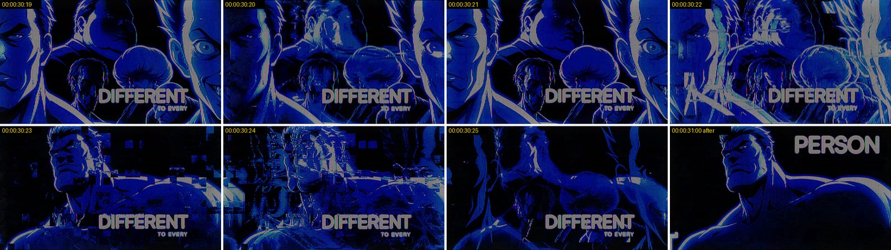
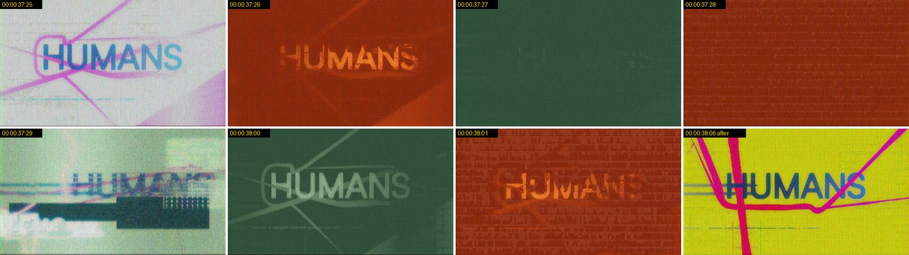

# Glitch cut transitions

> **First time?** This project's image generation and hosting run through [treg](https://treg.to/?ref=matthewdonse-aebsh). Sign up with
> [this link](https://treg.to/?ref=matthewdonse-aebsh), install the CLI (`curl -fsSL https://treg.to/install.sh | sh`), run `treg login`,
> then check it with `treg balance`.

Every cut in the launch film (`textAnimations`, comp `launch film`) is a few frames of glitch instead of a straight cut.
Around each cut the outgoing shot keeps running past it and the incoming shot starts early. The two are mixed frame by
frame with a double exposure, a brightness displacement, datamosh blocks, cut-in rectangles, echo trails, 1-frame
flicks and a colour tint, with a pixel-sort burst right on the cut. On top go a glitch layer lifted out of a reference
edit and a short exposure blow-out. The ending's title cards get the same blend, and every third cut gets the red
flash from the Edgerunners 2 teaser instead. All of it is built from the picture rendered clean, then placed in
EffectCraft under the CRT / VHS look, so the look stays live on top.

## The reference

The reference TikTok edits matt gave (`projects/opening/ref/tt_elements*/`), where almost every frame has two shots
in it (from the `make_cut_blend.py` docstring). The effects were read off their frames: luma blend into blown-out
whites tinted cyan, magenta or blue; displacement smeared along the rows; datamosh blocks; rectangles of the other
shot; echo trails; hard 1-frame flicks. `extract_fx.py` also pulled four of their glitch effects out as transparent
layers (chroma, streaks, noise, lines), which are screened over the bigger cuts. The ending's red flash is generated
from numpy seeds taken from Edgerunners 2 Teaser #2 at 1:24 (`plugins/redflash/seed.py`).

## How it works

### 1. Shot A, shot B, and the frames between

*The opener's cut at frame 332 (00:00:11:02), from `assets/collage/process/transition_howto.jpg`: shot A (the man at
the chalkboard), shot B (the cyberpsycho close-up), then the five blend frames. Blend 1 is still mostly A. Blend 2 is
displacement and smear. Blend 3 prints B's face into A. Blend 4 is datamosh blocks. Blend 5 is a cut-in rectangle
with an echo.*

For each cut the scripts take `n` frames either side, at most 6, fewer when the next cut is close. Before the cut,
shot B is pulled in early by playing its first frames backwards from the cut. After the cut, shot A runs on by playing
its last frames backwards. A mix value goes from all A to all B across the window, and a "heat" value peaks on the cut
frame, so the glitch is strongest there.

### 2. What happens on each frame

*Every frame of the window round the opener's first cut (frame 23, `assets/collage/secblend/opening/0023/`), k = -6
to +6. Its tint is the pale one, `TINTS[(23 // 7) % 4]`.*

Each frame rolls dice, seeded per cut so a rerun gives the same result:

- **1-frame flick (22%):** just A or B, pushed brighter and tinted. Nothing else that frame.
- **Double exposure (otherwise):** the brighter shot lifted half a stop, the other shot's dark shapes and line work
  multiplied into it, and its highlights screened back on top.
- **Displacement (70%):** the frame pushed sideways by the other shot's blurred brightness and up and down by its
  edges, then smeared along random bands of rows.
- **Datamosh (up to 30% at the cut):** 32-64 px blocks of the other shot dropped in wherever the new shot moves.
- **Cut-in rectangles (45%):** 1-4 boxes of the other shot pasted in, slightly slid sideways.
- **Echo trail (50%):** the previous frame stepping out sideways behind it, 1-3 copies, each one dimmer.
- **Exposure and tint (always):** a push brighter near the cut, then a duotone: black, to one of four colours
  (cyan, magenta, blue, pale), to white.

*The window on the first bust change in `cyberpunk` (its frame 659, 00:00:30:22 in the film): the ensemble
shredding into the first bust.*

### 3. The pixel-sort burst

*Top: the film's frames 22-25 round the first cut. Bottom: their pixel sort (`assets/collage/cutfx/cut_00/`), shown on
black. Only the sorted runs have alpha.*

Rows are split into bands 4-40 px tall and about half the bands sort. In a sorting band every run of bright pixels
longer than 6 px is sorted by brightness, one way or the other, so highlights smear into streaks. In the current
build this is mixed into the blend frames right on the cut (k = -1, 0, +1).

### 4. On top: the reference glitch and the exposure ramp

On cuts with a window of 3 or more frames, one of the four effects extracted from the reference edit (RGB glitch,
pixel blocks, eye-noise streaks, eye close-up lines) is laid over it in Screen mode at 55%, for 4 frames, rotating.
One adjustment layer per section runs an exposure expression: it ramps up to +0.55 stop over the 0.1 s before each cut
and back down over the 0.2 s after.

### 5. The ending: blends and red flashes between the cards

*`assets/collage/ending_transitions_stills.jpg`: clip blends and red flashes between the ending's cards.*

*The 5 red-flash frames placed over the ending's second card change (`assets/collage/endtrans/cut_01/`): bar, slab,
eye, rings, fill. Each one is a new variation generated from the teaser's seeds.*

The ending's cuts are read from the project: every point where a caption card starts, plus the cut into the end card.
Every third cut gets a red flash, if there's room. The others get the blend (2-5 frames either side) with the pixel
sort on the cut. One `text glitch` adjustment layer also hits the type with Digital Glitch and Turbulent Displace on
each card's first three and last two frames.

### 6. Into EffectCraft, under the look

The picture is rendered without the look: CRT, VHS, captions and old cut effects switched off. The transitions are
built from those clean frames. Each cut's frames go into the section comp as their own named layer (`cutblend opening
332`, `end trans 3 blend`), trimmed to the window and placed just above the picture. The captions, CRT-Emulator, VHS
look and 4:3 bars stay live on top. An earlier version put the blends on top of the whole `launch film`, over the CRT
and captions and only on the edit's cuts. The section build replaced it and removes those layers.

## In the film

From `textAnimations/renders/launch_film_final_full.mp4`, with the CRT and captions on top.

*00:00:10:29 to 00:00:11:05, the cut at 00:00:11:02, and 00:00:11:10 after. Transitions run on every cut from
00:00:00:23 to 00:00:37:13.*

*00:00:30:19 to 00:00:30:25: the ensemble into the first bust, then 00:00:31:00.*

*00:00:37:25 to 00:00:38:01: the first card change in the ending (00:00:37:28), into the yellow HUMANS card at
00:00:38:06. The ending's transitions run 00:00:37:28 to 00:00:58:09.*

## The files

| File | What it is |
| --- | --- |
| `textAnimations/assets/make_cut_blend.py` | The blend itself (`blend_frame`, `luma_blend`, `displace`, `datamosh`, `rects`, `echo`, `tint`, `TINTS`), first used at `launch film` level |
| `textAnimations/assets/make_cut_fx.py` | `pixel_sort`, plus the first screened-glitch and exposure-ramp placement |
| `textAnimations/assets/make_section_cuts.py` | Current build for `opening` and `cyberpunk`: finds the cuts in the clean frames, builds the blends |
| `textAnimations/assets/make_ending_transitions.py` | The ending's blends and red flashes, `cuts.json` |
| `textAnimations/assets/extract_fx.py` | Pulls the glitch layers out of the reference edit |
| `textAnimations/plugins/redflash/seed.py` | The red flash generator, seeded from the teaser |
| `textAnimations/plugins/launchSectionCuts.jsx` | Generated: places the section blends, glitch and exposure ramp |
| `textAnimations/plugins/endingTransitions.jsx` | Places the ending transitions and the text glitch |
| `textAnimations/plugins/launchCutBlend.jsx`, `launchCutFx.jsx` | Generated, superseded `launch film`-level versions |
| `textAnimations/plugins/CRTemulator/applyOpening.jsx`, `applyCyberpunk.jsx` | The VHS / CRT look that sits on top |
| `textAnimations/assets/make_process_sheets.py` | Makes `transition_howto.jpg` |

Agent instructions, parameters and run order are in [SKILL.md](SKILL.md).

## Assets

Everything this skill needs to run again (scripts, plugins, LUTs, seeds, sprites, data) is copied into
[`assets/`](assets/MANIFEST.md) at the same paths it has in the repo. The manifest lists what's bundled, what's shared with
another skill, and which big media (renders, projects, reference videos) stays in the repo.
