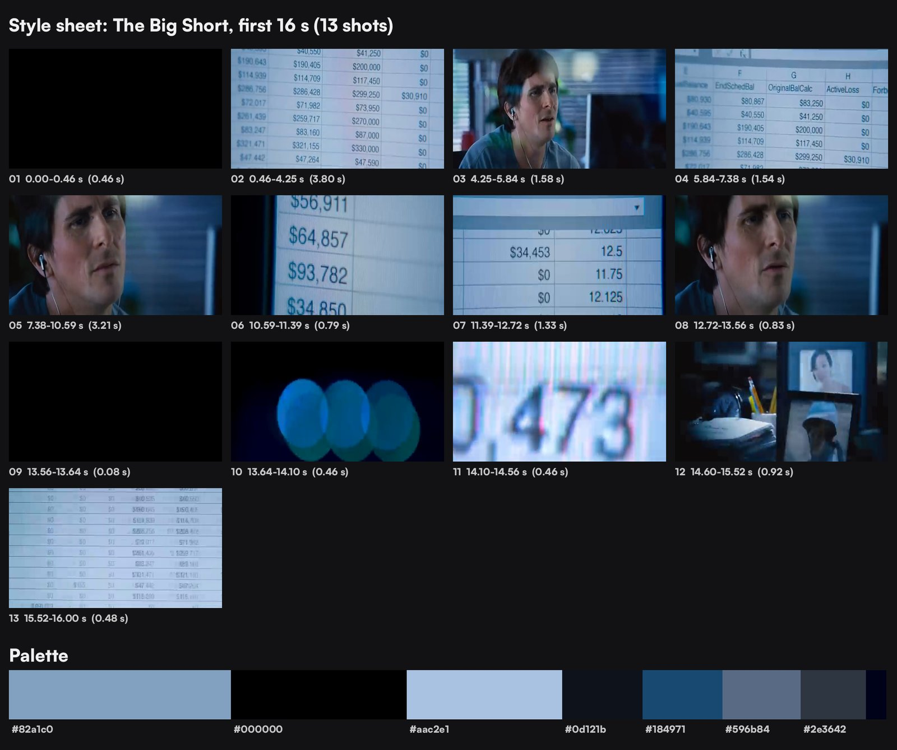
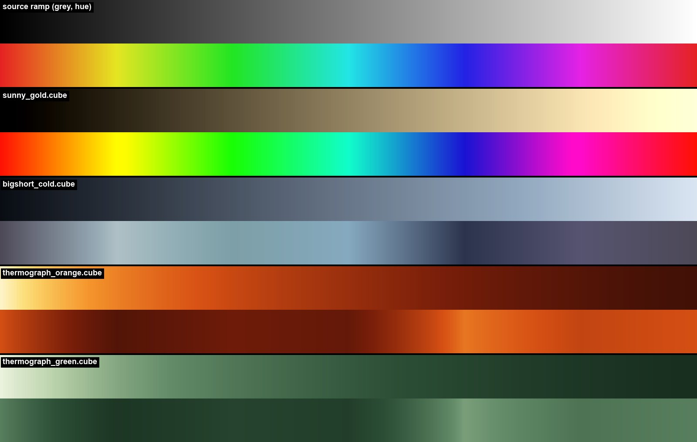
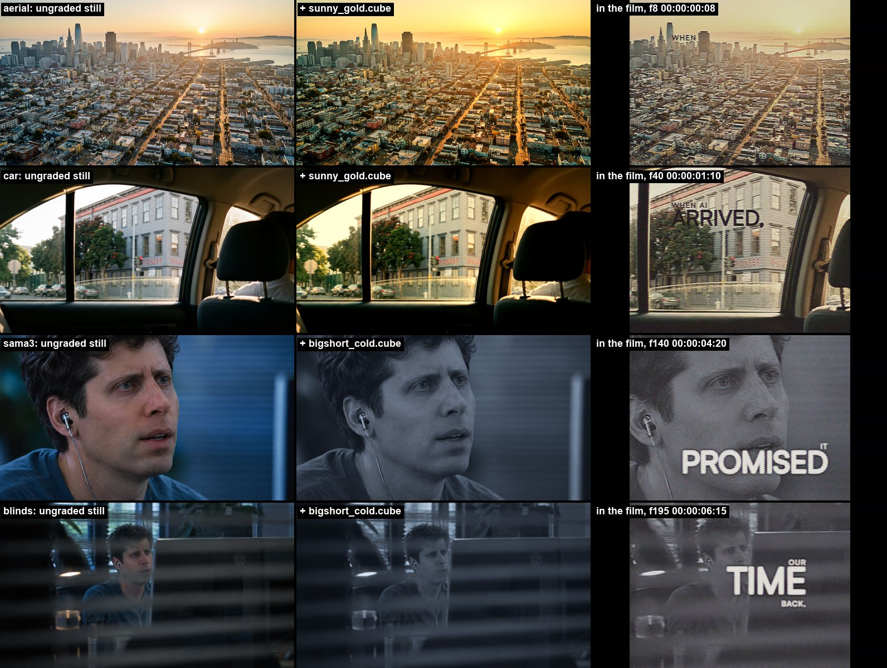
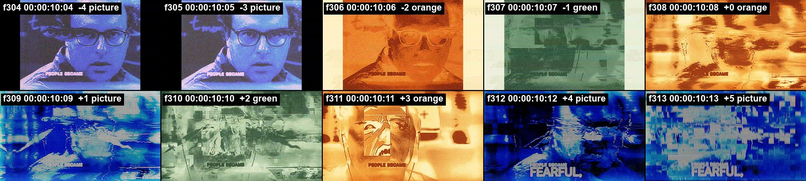

# Grade and thermal cuts

> **First time?** This project's image generation and hosting run through [treg](https://treg.to/?ref=matthewdonse-aebsh).
> Sign up with [this link](https://treg.to/?ref=matthewdonse-aebsh), install the CLI
> (`curl -fsSL https://treg.to/install.sh | sh`), run `treg login`, then check it with `treg balance`.

## What it is

Two pieces of colour work from the launch film.

1. **A grade per shot.** The opener's stills came from different generations and didn't match. Each shot now gets
   one of two LUTs: a sunny gold for the shots outside and in the car, and The Big Short's cold blue-grey for every
   shot inside. Outside reads warm and hopeful, inside cold and corporate.
2. **The thermogram cut.** On a scene switch, the frames round the cut flash through a thermal-camera look, orange
   and green with the brightness flipped so dark reads hot, inside an exposure blow-out. It's on the opener's drop,
   cyberpunk's match cut and Intro 1's cuts.

Both are LUT files written by small numpy scripts and applied in EffectCraft as editable effects and expressions.

## The reference

*`projects/opening/ref/bigshort_stylesheet.png`: The Big Short's first 16 s (13 shots) and its palette. The cold
grade maps every inside shot onto these blue-greys.*

## How it works

### 1. Two grades as LUTs

`make_opening_luts.py` writes two 33-point `.cube` files. The cold one drains most of the colour and maps brightness
onto The Big Short's palette, from near-black navy through slate to pale blue, keeping a quarter of the original
colour so skin doesn't go dead. The sunny one lifts reds and greens, pulls blues down, adds a little saturation and a
gentle S-curve.

*A grey ramp and a hue ramp, then the same two ramps through each LUT (applied with ffmpeg's `lut3d`): sunny gold,
the cold Big Short blue-grey, and the two thermograph LUTs, where the dark end comes out hottest.*

### 2. One LUT per shot

`openingGrade.jsx` puts an Apply LUT effect named `Grade` on every shot in the opener: sunny gold if it's the aerial
or the car window, cold for everything else. The opener's VHS look and CRT go on top of it.

*Left, the ungraded stills (`projects/opening/cast/aerial.png`, `projects/opening/gpt3/carwindow_moving_raw.png`,
`projects/opening/mattgen/sama3.png`, `.../Through the Blinds_ Focused Tech Workspace.png`). Middle, the same still
through its LUT (ffmpeg `lut3d`, for this page). Right, the shot in the finished film, with the VHS look on top.*

### 3. The thermogram cut

`make_thermograph_luts.py` writes the two thermal LUTs: brightness flipped, then through an orange or a green heat
ramp. Two adjustment layers carry them, each switched on only on its frames by an opacity expression:

| Frame from the cut | -2 | -1 | 0 | +1 | +2 | +3 |
|---|---|---|---|---|---|---|
| Look | orange | green | orange | picture | green | orange |

A third adjustment layer blows the exposure out over the 0.3 s before the cut and brings it back over the 0.4 s
after, held low on the thermal frames so the colours read. Everything sits on top of the CRT.

*The drop in the finished film, frames 304-313: the man behind the blinds, then orange (-2), green (-1), orange on
the cut (0, 00:00:10:08), one picture frame (+1), green (+2), orange (+3), and into the cyberpsycho shout.*

## The result in the film

`textAnimations/renders/launch_film_final_full.mp4`:

| Timecode | What |
|---|---|
| 00:00:00:00-00:00:01:24 | sunny gold: the aerial and the car window |
| 00:00:01:26-00:00:10:07 | cold Big Short blue-grey: every shot inside |
| 00:00:10:06-00:00:10:11 | the thermogram cut on the drop into the cyberpsycho shout |
| 00:00:17:16-00:00:17:21 | the same transition in cyberpunk, on the zoom from the overheads into the close-ups |

(The thermal frames are found by colour in the render. The grade spans are read off its frames.)

## Files

| File | What it does |
|---|---|
| `textAnimations/assets/make_opening_luts.py` | writes `sunny_gold.cube` and `bigshort_cold.cube` |
| `textAnimations/plugins/openingGrade.jsx` | one Apply LUT per opener shot |
| `textAnimations/assets/luts/make_thermograph_luts.py` | writes `thermograph_orange.cube` and `thermograph_green.cube` |
| `textAnimations/plugins/openingThermal.jsx` | the thermogram on the opener's drop |
| `textAnimations/plugins/thermalCuts.jsx` | the thermogram on Intro 1's cuts |
| `textAnimations/plugins/cyberpunkEyes.jsx` | the thermogram on cyberpunk's match cut |
| `textAnimations/assets/luts/*.cube` | the four LUTs |
| `projects/opening/ref/bigshort_stylesheet.png` | the cold grade's reference |
| `textAnimations/launchFilm_final.ecproj` | the saved project with all of it in |

## Assets

Everything this skill needs to run again (scripts, plugins, LUTs, seeds, sprites, data) is copied into
[`assets/`](assets/MANIFEST.md) at the same paths it has in the repo. The manifest lists what's bundled, what's shared with
another skill, and which big media (renders, projects, reference videos) stays in the repo.
