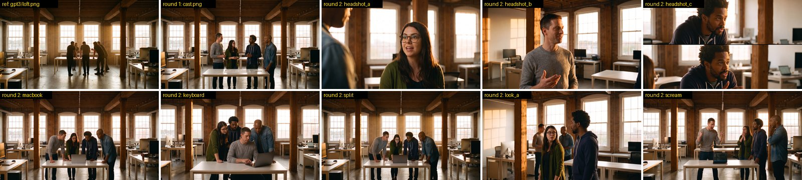
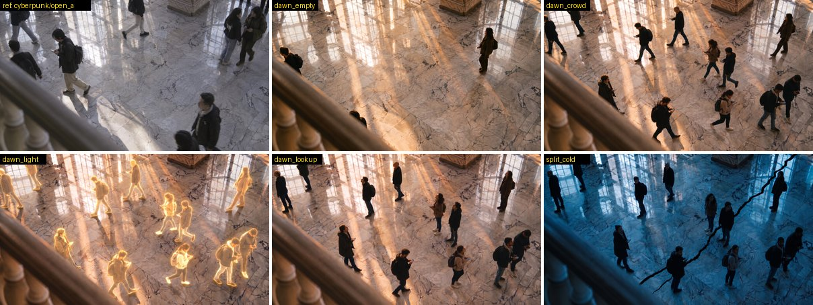
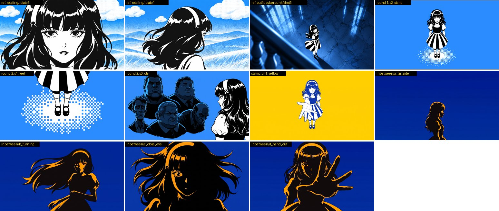
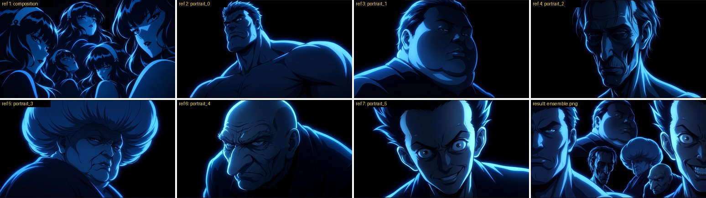
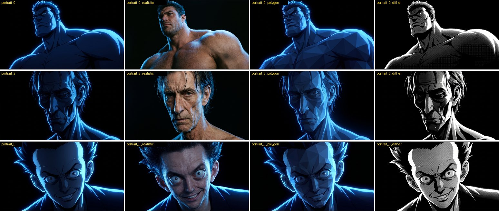
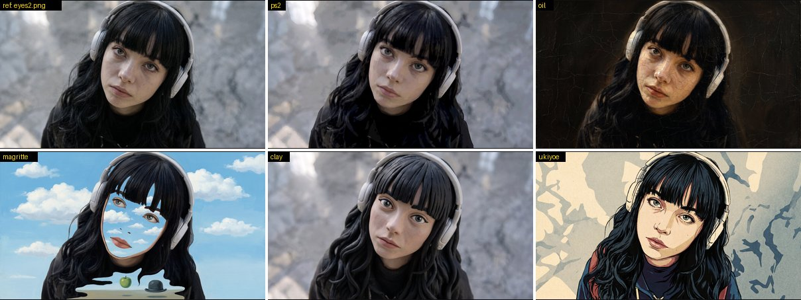
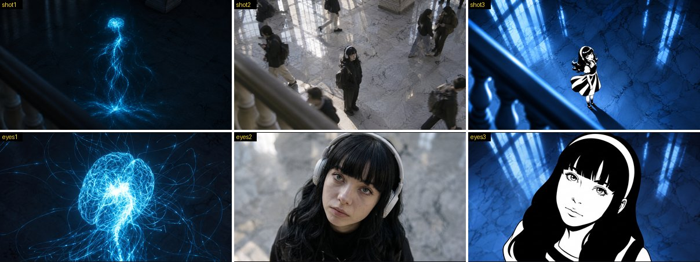
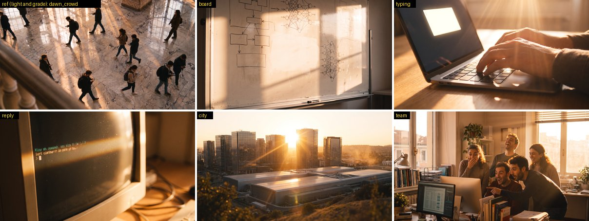
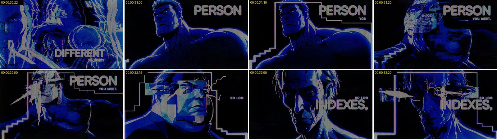
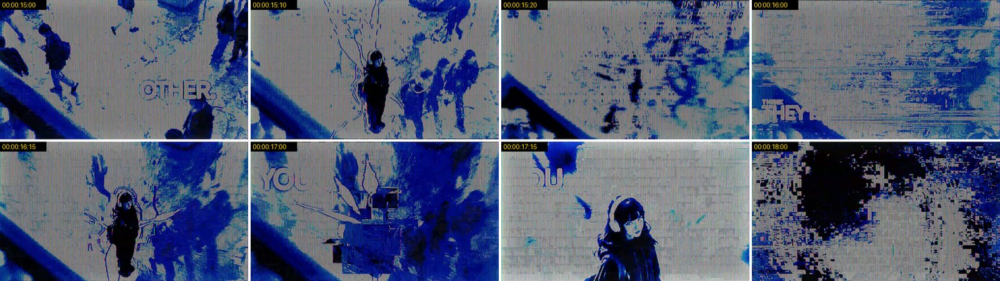

# Locked image generations

> **First time?** The image generations here run through [treg](https://treg.to/?ref=matthewdonse-aebsh). Sign up with
> [this link](https://treg.to/?ref=matthewdonse-aebsh), install the CLI (`curl -fsSL https://treg.to/install.sh | sh`), run `treg login`,
> then check it with `treg balance`.

Every still in the launch film was generated with Nano Banana Pro (Gemini 3 Pro Image). The stills had to cut
together, match-cut on the eyes, and be glitch-collaged over each other, so they were generated in chains. The first
image (a cast sheet, a standing girl, a locked-off hall) is made and approved first, then passed as the reference for
every later shot. Faces, clothes and places stay the same that way. When a shot needs other versions (another style,
another moment), the prompt locks the camera, crop and pose so the versions sit on top of each other. Text is left out
of the pictures and added later as editable layers. The opening scripts keep the raw download beside the resized
1920x1080 still.

## The reference

The references are whatever each chain starts from: a still of the Pioneer Building loft (`projects/opening/gpt3/loft.png`)
for the cast, cyberpunk's overhead hall (`projects/cyberpunk/open_a.png`) for the dawn hall, the ink anime girl
(`images/rotating/`) and her dress (`projects/cyberpunk/shot3.png`) for the stamp girl, `images/Blue Noir Headband
Portraits.png` for the busts and the crowd, and the frames of matt's 1:05 lighting reference
(`projects/opening/ref/yt_line/lighting/`) for the in-betweens.

## How it works

### 1. Two ways to call the model

- **[treg](https://treg.to/?ref=matthewdonse-aebsh)'s hosted endpoint** (`reapi.image-gen.gemini-3-pro-image`, about $0.03 an image). Each reference is uploaded
  with `treg host`, the URLs go in `image_urls`, and the result is downloaded with curl. treg's hosting quota is a
  rolling 300 MB a day.
- **Google's endpoint through treg** (`google-ai.image-gen.gemini-3-pro-image`, about $0.15 an image). The references
  go in the request itself as base64 JPEGs, so nothing is hosted. Used for the bust styles, the yellow girl and the
  in-betweens.

Both ask for 16:9 at 2K. Each script skips a still that already exists.

### 2. Chain the rounds

*`make_opening_cast.py`. Round 1: the loft photo goes in, and the cast sheet (`cast.png`) comes out: four original
characters together. Round 2: every shot is made with the cast sheet as the first reference and the loft as the
second, and the prompt starts "The SAME four people as in the first reference image". The faces and clothes carry
from shot to shot.*

*`make_opening_dawn.py`, run in order: cyberpunk's `open_a` gives `dawn_empty`, which gives `dawn_crowd`, which gives
`dawn_light` and `dawn_lookup`, and `dawn_lookup` gives `split_cold`. Every prompt says it is "the SAME locked-off
camera shot" and keeps "the same people in the same positions and sizes", so only the light and the people's state
change.*

*`make_stamp_shots.py`. Round 1: her standing shot `s2_stand`, from two drawings of the girl and her dress. Round 2:
`s1_feet` and `s0_ots` from `s2_stand`. Later scripts also start from `s2_stand`: `make_yellow_woman.py` puts her on
flat yellow inked in blue, and `make_girl_inbetweens.py` puts her in the 1:05 lighting (far, turning, close on one
eye, hand out).*

*`make_caricature_ensemble.py`: the Headband Portraits image as the composition (first), the six busts as who goes
where. The result keeps every figure's position, size and crop.*

### 3. Lock camera, crop and pose across styles

*`make_bust_styles.py`: each bust (left) redrawn as a real photograph, a low-poly render and 1-bit Bayer dither. The
prompt asks for "the face at exactly the same position and size in the frame, the same crop and camera, so it lines
up with the reference pixel for pixel", and each result is resized to the source's exact size.*

*`make_cyberpunk_variants.py`: the photo close-up `eyes2` redrawn as PS2, Caravaggio oil, Magritte, claymation and
ukiyo-e. The prompt names the same camera angle, head tilt, gaze and the positions and sizes of the eyes, nose, mouth,
hair and headphones.*

*`make_cyberpunk_eyes.py`: one close-up per overhead shot, each in that shot's own style, all framed with the point
between the eyes at frame centre so the cuts between them match on the eyes. `eyes3` is `eyes2` redrawn as the anime
girl from `shot3`.*

### 4. Leave the text out

*`make_opening_creation.py`: `dawn_crowd` (top left) is the reference for light and grade only. The prompts ask for "no
readable text, no logos, no brand names": the whiteboard has a large empty space in the middle and the laptop shows a
plain white text box, so the words can go in as editable layers.*

### 5. Keep the raw, clean up after

The opening scripts save the download as `<name>_raw.png` (or `.jpg`) and write the 1920x1080 `<name>.png` beside it.
Flat backgrounds came back textured, so `flatten_stamp_bg.py` keeps only the black, white and grey (the figures and
their dither shadows) and makes everything else flat `#2a8cff`.

## In the film

From `textAnimations/renders/launch_film_final_full.mp4`.

*00:00:30:22 to 00:00:33:20: the busts, each glitching between its original, realistic, low-poly and dither versions.
They can cut in rectangles and quadrants because all four line up.*

*00:00:15:00 to 00:00:18:00: cyberpunk's locked-off overhead hall: the crowd moves and the camera, railing and floor
stay put. Under the CRT.*

## The files

| Script (`images/gen/`) | Makes |
| --- | --- |
| `make_opening_cast.py` | `projects/opening/cast/`: cast sheet, then 10 shots from it |
| `make_opening_dawn.py` | `projects/opening/dawn_*.png`, `split_cold.png`: the hall chain |
| `make_opening_creation.py` | `projects/opening/creation/`: the creation of AI, golden, no text |
| `make_cyberpunk_eyes.py` | `projects/cyberpunk/eyes1-3.png` |
| `make_cyberpunk_variants.py` | `projects/cyberpunk/variants/eyes2/<style>.png` |
| `make_variants.py` | `images/variants/<still>/<style>.png`: Intro 1's 8 styles (where the style lines come from) |
| `make_cyberpunk_turn.py` | `projects/cyberpunk/outro/portrait_0-5.png` and `turn_*.png` |
| `make_bust_styles.py` | `projects/cyberpunk/outro/styles/portrait_<i>_<realistic|polygon|dither>.png` |
| `make_caricature_ensemble.py` | `projects/cyberpunk/outro/ensemble.png` |
| `make_stamp_shots.py` | `projects/stamp/s2_stand.png`, `s1_feet.png`, `s0_ots.png` (the script also defines three group shots, `s3`-`s5`, which aren't in `projects/stamp/`) |
| `make_yellow_woman.py` | `projects/cyberpunk/outro/stamp_girl_yellow.png` |
| `make_girl_inbetweens.py` | `projects/cyberpunk/outro/inbetween/<shot>.png` |
| `flatten_stamp_bg.py` | flat brand-blue background clean-up |

Agent instructions, exact API calls and prompt strings are in [SKILL.md](SKILL.md).

## Assets

Everything this skill needs to run again (scripts, plugins, LUTs, seeds, sprites, data) is copied into
[`assets/`](assets/MANIFEST.md) at the same paths it has in the repo. The manifest lists what's bundled, what's shared with
another skill, and which big media (renders, projects, reference videos) stays in the repo.
