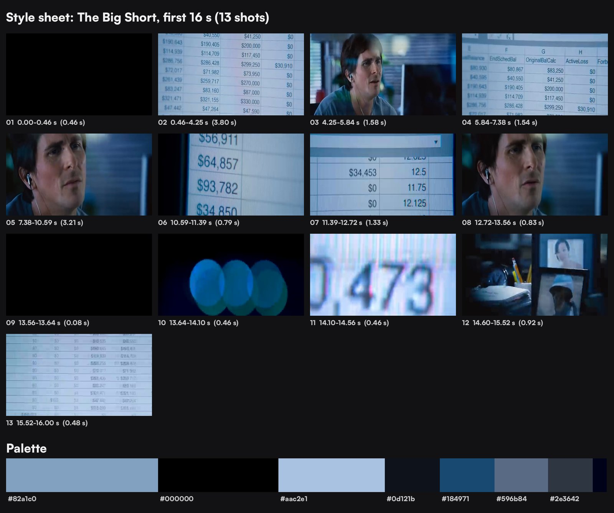
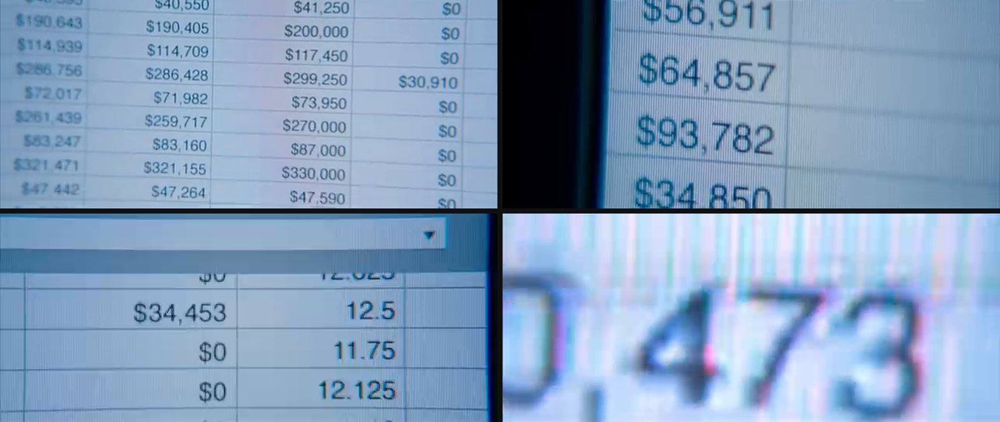
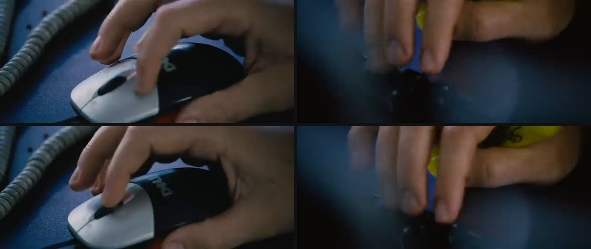
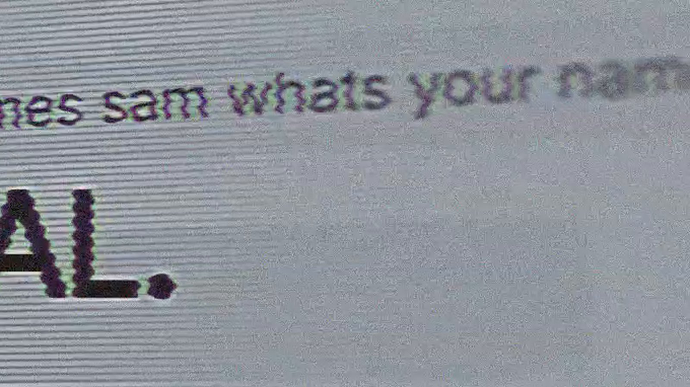
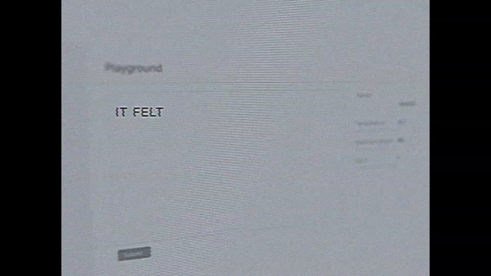
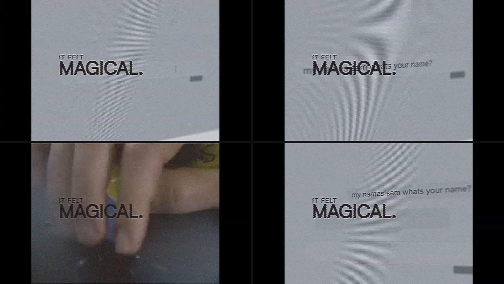
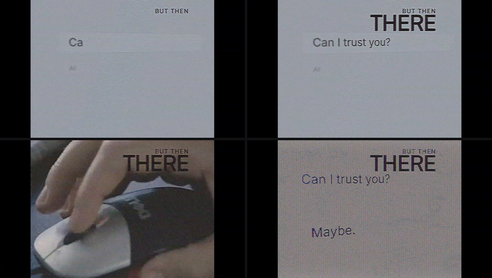
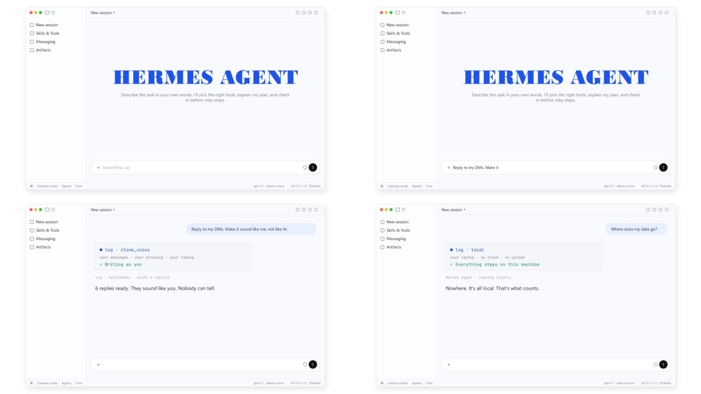

# Screen UI typing: native screens filmed in 3D

> **First time?** This project's image generation and hosting run through [treg](https://treg.to/?ref=matthewdonse-aebsh). Sign up with
> [this link](https://treg.to/?ref=matthewdonse-aebsh), install the CLI (`curl -fsSL https://treg.to/install.sh | sh`), run `treg login`,
> then check it with `treg balance`.

The launch film's opener has four computer screens: the GPT-3 Playground, a ChatGPT chat ("my names sam whats your
name?" / "My name is ChatGPT.") and "Can I trust you?" / "Maybe.". None of them is a generated picture. Each is a
precomp of live text and shapes in EffectCraft, with the prompt typing in, covered by an RGB subpixel grid, then
tilted as a 3D layer under a camera with depth of field, so only the message is sharp, like The Big Short's
macro shots of a monitor. Short cutaways of a hand clicking a mouse and a finger pressing a key, taken from the style
reference, are cut in at the moments each prompt is sent. This page shows the references, how it's built, where it is
in the film, and the related screen builds (the Hermes Agent app and terminal, the typewriter variations).

## The reference

*The Big Short's first 16 seconds (`projects/opening/ref/bigshort_stylesheet.png`): spreadsheet numbers on a monitor,
shot macro and tilted with very shallow focus, intercut with the face, in a cold blue-grey palette.*

*The monitor shots up close (`bigshort_01`, `05`, `06`, `10`): the screen at an angle, one line sharp and the rest
falling off into blur, the pixel structure visible.*

*Top: The Big Short's hand on the mouse (52.7 s) and finger on the key (26.7 s). Bottom: the same moments in the style
reference `styleref.mp4` at 52.09 s and 26.40 s, which are the frames the film's inserts are cut from.*

## How it's built

### 1. The flat screen, as live layers
Each screen is a 2D precomp (`screen ui playground`, `screen ui chat`, `screen ui trust`) of shape layers and Inter
text, in the colours of a light chat app: input box, bubbles, the green send / Submit button. The comp is 3840x2700
with the 1920x1080 layout in the middle, so when it's tilted it still fills the frame (matt didn't want black bars).
On top is the subpixel grid (`assets/opening/pixelgrid.png`) in Multiply at 70%.

### 2. The typing
The prompt types on with a hard left-to-right wipe that steps once per character (36 characters a second on the chat,
22 on "Can I trust you?", 30 on the Playground). A thin cursor follows the end of the text and blinks. At the send,
the input clears, the question appears as a sent bubble, and the reply types in under it. The two chat shots are two
camera angles on the same screen, with its time running on across the cut.

### 3. Filmed in 3D
The flat screen goes into a `screen 3D ...` comp as a 3D layer, turned about 16-22° on Y and 5-8° on X, its anchor on
the message so the message sits in the middle of the frame. A camera with depth of field (zoom 1600, aperture 130,
blur 100) pushes in slowly from 1600 to 1480 with its focus following, so the message stays sharp and the rest of
the screen goes soft. In the opener, each shot then gets The Big Short's cold blue LUT and a crash push-in with
shake (25% a second, measured from the film), under the opener's VHS look.

*A close-up of frame 116: "my names sam whats your name?" sharp on the left and blurring off to the right along the
tilted screen, with the grid and the VHS look over it.*

### 4. The inserts
Three 4-frame cutaways from `styleref.mp4`, scaled up to fill the frame height (they look soft, as the reference is
only 640x268): a mouse click as the Playground prompt goes to Submit, a finger press as the chat question sends, and
the mouse click again on "Can I trust you?".

## The result in the film

`textAnimations/renders/launch_film_final_full.mp4` (30 fps). The caption type ("IT FELT MAGICAL.", "BUT THEN
THERE") sits over the screens.

*The Playground, frame 74 (about 2.47 s; the shot runs 2.13-2.73 s).*

*The chat: frame 84 (the empty input, just after the mouse-click insert), frame 104 (the question typing), frame 108
(the finger-press insert), frame 116 (the question sent, the second angle). The reply follows to about 4.27 s.*

*"Can I trust you?": frame 228 (typing "Ca"), frame 232 (typed), frame 240 (the mouse-click insert), frame 246
("Maybe." has come back).*

In the script the inserts are at frames 78, 107 and 238; in this render they show at about 80, 108 and 240.

## Related builds

*`hermesharness` (`plugins/hermesHarness.jsx`): the Hermes Agent desktop app rebuilt from matt's screenshot, every
part its own layer. The empty app, the prompt typing into the input, and two of the four conversations (the bubble,
the tool card, the reply). Not used in the final film.*

- **The Hermes Agent terminal in 3D** (`plugins/endingTerminal.jsx`): four copies of the native `hermesAgentTerminal`
  each type one of the ending's lines and stand as 3D cards at different depths, with the camera swinging card to
  card. The film's final ending replaced it with the flat cards under the CRT.
- **The typewriter variations** (`typewriterVariations.mjs`): letter-by-letter type-ons with overshoot, timed by
  "in"/"out" markers, plus the Claude Code, Codex and terminal windows where a prompt types in, sends and gets a
  reply.

## Files

- `textAnimations/plugins/openingScreens.jsx`: the screens, the 3D shots, into the opener
- `textAnimations/assets/opening/pixelgrid.png`: the subpixel grid
- `textAnimations/plugins/openingInserts.jsx`: the three click / key inserts
- `textAnimations/plugins/openingGrade.jsx`, `textAnimations/assets/make_opening_luts.py`: the Big Short LUT
- `textAnimations/plugins/openingHandheld.jsx`: the crash push-ins
- `textAnimations/plugins/hermesHarness.jsx`: the Hermes Agent app
- `textAnimations/researchDepth.mjs`, `textAnimations/plugins/endingTerminal.jsx`: the Hermes Agent terminal in 3D
- `textAnimations/typewriterVariations.mjs`, `uiSceneKit.mjs`, `uiDemos.mjs`: the earlier typing builds
- References: `projects/opening/ref/` (`bigshort_stylesheet.png`, `bigshort_*.png`, `bigshort_camera.json`,
  `styleref.mp4`, `hermesharness_stills.jpg`)
- The agent instructions: [SKILL.md](SKILL.md)

## Assets

Everything this skill needs to run again (scripts, plugins, LUTs, seeds, sprites, data) is copied into
[`assets/`](assets/MANIFEST.md) at the same paths it has in the repo. The manifest lists what's bundled, what's shared with
another skill, and which big media (renders, projects, reference videos) stays in the repo.
