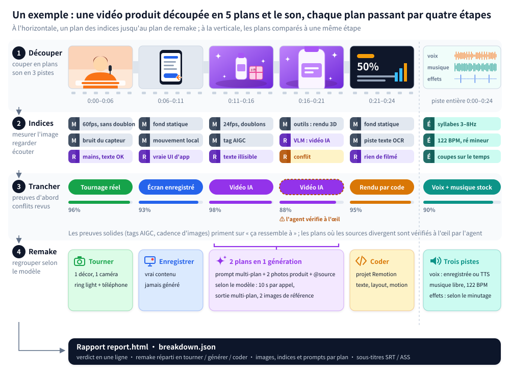

<div align="center">

<picture>
  <source media="(prefers-color-scheme: dark)" srcset="../docs/brand/logo-light.svg">
  
</picture>

Rétro-ingénierie de n'importe quelle vidéo.

Plan par plan : tourné, généré par IA ou codé, et comment le refaire.

[Site web](https://www.reavideo.ai) | [中文](README_zh.md) | [English](../README.md) | [Русский](README_ru.md) | [日本語](README_ja.md) | [한국어](README_ko.md) | [Español](README_es.md) | [Português](README_pt.md) | Français | [Deutsch](README_de.md)

[](https://github.com/JuneYaooo/rea-video/stargazers)


<a href="https://trendshift.io/repositories/334878" target="_blank"></a>

[](https://www.reavideo.ai) [](https://discord.gg/dZj8D3GqWT) [](https://x.com/yao_june12106)

⭐ *Une étoile sur le dépôt aide d'autres gens à découvrir rea-video !*


À gauche : une pub TikTok tournée au téléphone. À droite : un remake IA avec un autre produit. Verdict de rea-video : à gauche, tout est tourné, un seul décor, deux positions de caméra ; à droite, tout est en IA, 8 plans en 3 générations.

</div>

## Démarrage rapide

rea-video est pensé pour être piloté par un agent IA. Dans Claude Code, Codex ou n'importe quel agent capable de lancer des commandes, demandez :

```text
Installe https://github.com/JuneYaooo/rea-video, puis décortique cette vidéo : /path/to/video.mp4
```

L'agent installe la CLI, apprend le workflow et s'occupe du reste. Prérequis : ffmpeg et Python 3.10+.

<details><summary>Installation manuelle</summary>

```bash
brew install ffmpeg            # sudo apt install ffmpeg
git clone https://github.com/JuneYaooo/rea-video && cd rea-video
bash scripts/install_skill.sh  # installe la CLI (pip, sinon pipx / .venv local) et lie le skill → ~/.claude, ~/.codex, ~/.agents
rea-video --help
```

</details>

Ce que vous obtenez :

- un résumé en une ligne, par ex. « 41 % de vidéo IA + 59 % d'interface codée, 8 s de vrai enregistrement d'écran, musique de librairie à 122 BPM »
- un plan de remake qui sépare ce qu'il faut tourner, ce qu'il faut générer et ce qu'il faut coder
- un `report.html` complet : images de chaque plan, indices, prompts, notes sur la caméra et l'éclairage, analyse du son

Vous pouvez brancher un modèle qui comprend la vidéo — Gemini et Doubao marchent tous les deux : il suffit de donner l'endpoint et la clé à l'agent. Le tri réel / IA / 3D devient plus fiable, et chaque plan reçoit un prompt reconstitué. Sans modèle, ça marche aussi ; si votre agent sait lire les images, il revérifie lui-même les plans douteux.

> Le rapport est rédigé dans la langue de votre demande (chinois ou anglais). Les rapports d'exemple ci-dessous sont en anglais.

## Ce qu'il sait analyser

| Type de vidéo | Exemples | Ce que vous obtenez |
|---|---|---|
| Prise de vue réelle | Face caméra, table top, démo produit à la main, vlog, visite de boutique | Décors et positions de caméra, cadrage, mouvements de caméra, éclairage (12 schémas, avec la liste du matériel), étalonnage |
| Vidéo IA | Texte/image vers vidéo, mini-série IA, clip musical IA | Indices, un prompt reconstitué par plan, comment regrouper les plans en générations et avec quel modèle |
| Avatar | Un portrait animé par une piste audio, lip-sync | Quels plans sont des avatars, quel portrait et quel audio prévoir |
| 3D / animation | Vidéos explicatives Blender / C4D, animation produit, animation 2D, stop-motion | Faut-il générer avec un modèle vidéo ou faire le rendu depuis du code 3D |
| Code / template | Typographie animée, démos d'interface, graphiques, cartons façon diapo | Texte, mise en page et timing des animations, de quoi tout reconstruire en projet Remotion |
| Enregistrement d'écran | Tutoriels logiciels, démos web | Les parties qui sont du vrai matériel, à enregistrer vous-même |
| Mixte / montages | Personnages IA + interface codée + vraie capture d'écran ; prise de vue réelle retouchée à l'IA | Chaque plan est analysé à part, puis remis à sa place sur la timeline d'origine |

Au-delà de la façon dont l'image a été produite, chaque vidéo est aussi analysée sur :

- Sous-titres et textes stylisés : début et fin de chaque ligne (export SRT / ASS), couleur, contour et animation d'entrée du texte
- Stickers, emoji, incrustations : leur position et leur durée à l'écran
- Montage : où tombent les coupes, à quel rythme, et si elles sont calées sur le tempo
- Son : voix humaine ou IA, musique IA ou de librairie et son BPM, position de chaque effet sonore
- Matériel à fournir vous-même : enregistrements d'écran, captures d'écran, photos produit

## Exemples

Les vidéos d'exemple dans `docs/cases/videos/` ont été recompressées pour garder un dépôt léger, ce qui efface les tags de plateforme TikTok / Douyin. Si vous les analysez vous-même, vous n'obtiendrez donc pas tout à fait les mêmes résultats que dans les rapports ci-dessous, surtout sans modèle de vision. Pour reproduire, partez du fichier téléchargé depuis la plateforme.

<table>
<tr>
<td width="50%" valign="top">
<a href="../docs/cases.md#2-混合片ai-人物对话--代码界面--真实录屏"></a><br>
<b>Clip multimédia mixte</b> · 19 s · 10 plans<br>
Personnages IA qui discutent + interface codée + 8 s de vrai enregistrement d'écran. Les 5 plans de dialogue sont coupés par des passages d'interface, mais ils partagent le même décor : une seule génération suffit.<br>
<a href="../docs/cases/videos/dual_role.mp4">Vidéo</a> · <a href="../docs/cases/dual_role/report_en.md">Rapport</a>
</td>
<td width="50%" valign="top">
<a href="../docs/cases.md#3-3d-科普片咸鸭蛋为什么会流油"></a><br>
<b>Vidéo explicative 3D</b> · 67 s · 21 plans<br>
Tout en 3D, voix off IA. Faisable en 10 générations vidéo, ou en demandant à un LLM d'écrire du code Blender / Three.js.<br>
<a href="../docs/cases/videos/salted_egg.mp4">Vidéo</a> · <a href="../docs/cases/salted_egg/report_en.md">Rapport</a>
</td>
</tr>
<tr>
<td width="50%" valign="top">
<a href="../docs/cases.md#4-代码-ui-动效产品宣传片"></a><br>
<b>Vidéo promo produit</b> · 70 s · 12 plans<br>
83 % de motion design en code, 12 % d'enregistrement d'écran. Pas besoin de modèle vidéo : un seul projet Remotion suffit.<br>
<a href="../docs/cases/videos/v10_oiioii_gen_coding_first.mp4">Vidéo</a> · <a href="../docs/cases/v10/report_en.md">Rapport</a>
</td>
<td width="50%" valign="top">
<a href="../docs/cases.md#5-ai-音乐-mv歌是-ai-写的还是曲库的"></a><br>
<b>Clip musical IA</b> · 165 s · 86 plans<br>
La chanson est bien identifiée comme générée par IA (elle a été faite avec Suno). Le modèle de vision voyait dans certains plans du « drame en prise de vue réelle » ; l'agent a repéré de faux caractères chinois sur un rouleau et les a classés en IA.<br>
<a href="../docs/cases/videos/qing_mv.mp4">Vidéo</a> · <a href="../docs/cases/qing_mv/report_en.md">Rapport</a>
</td>
</tr>
<tr>
<td width="50%" valign="top">
<a href="../docs/cases.md#6-实拍带货沉浸式开箱"></a><br>
<b>Unboxing en prise de vue réelle</b> · 72 s · 29 plans<br>
Entièrement tourné : un téléphone fixé en plongée, un tapis, une seule position de caméra, pas de voix off, son d'ambiance et musique de fond de librairie. Après le transcodage de la plateforme, l'outil hors ligne en classait 35 % en IA ; après vérification par l'agent, on arrive à 97 % de prise de vue réelle.<br>
<a href="../docs/cases/videos/unboxing.mp4">Vidéo</a> · <a href="../docs/cases/unboxing/report_en.md">Rapport</a>
</td>
<td width="50%" valign="top">
<a href="../docs/cases.md#7-ai-与真人混合用自己的出镜视频生成带货片"></a><br>
<b>Hybride IA + personne réelle</b> · 58 s · 21 plans<br>
75 % réel (face caméra + écran de téléphone filmé) et 25 % IA : la créatrice a fourni à Jimeng son propre clip face caméra et deux photos produit pour générer un passage produit « avec une vraie personne ». La partie IA a été trahie par le filigrane Jimeng et le texte illisible sur la boîte cadeau.<br>
<a href="../docs/cases/videos/ai_daihuo.mp4">Vidéo</a> · <a href="../docs/cases/ai_daihuo/report_en.md">Rapport</a>
</td>
</tr>
</table>

## Remakes

Une fois la vidéo analysée par rea-video, la recette de remake de [capsule-cinema](https://github.com/JuneYaooo/capsule-cinema) en génère une nouvelle version : caméra, mouvements, rythme et transitions reprennent l'original, et seuls les éléments que vous choisissez changent.
Ces résultats ont été générés avec MiniMax H3 auto-hébergé : le plan d'origine sert de référence de mouvement, et des images clés où les éléments ont été remplacés (gpt-image-2) fixent le rendu.
Voici trois remakes présentés par OiiOii dans ses articles WeChat. Pour chacun, nous avons fait deux versions : une avec le même remplacement qu'OiiOii, et une autre qui change aussi le sujet, le décor et les accessoires.
Chaque GIF fait défiler quatre versions en synchro : l'original, le remake d'OiiOii, le nôtre et la version avec éléments remplacés.

<table>
<tr><td>
<b>Changement de tenue vu du dessus</b> · 12 s<br>
Même remplacement : femme → homme, trois tenues → leurs équivalents masculins. Éléments remplacés : une jeune fille en trois tenues Hanfu historiques dans un cabinet d'étude chinois ; la télécommande devient un éventail rond.<br>
<br>
<a href="../docs/cases/remake/outfit_compare.mp4">Vidéo comparative HD (avec son)</a> · <a href="../docs/cases/remake/outfit_sheet.jpg">images au même instant</a>
</td></tr>
<tr><td>
<b>Animation papier découpé / aquarelle</b> · 30 s<br>
Même remplacement : une nouvelle héroïne, une fille en pâte à modeler. Éléments remplacés : un renard ; forêt → récif corallien, nuages → ciel étoilé, coucher de soleil → aurore boréale.<br>
<br>
<a href="../docs/cases/remake/paper_compare.mp4">Vidéo comparative HD (avec son)</a> · <a href="../docs/cases/remake/paper_sheet.jpg">images au même instant</a>
</td></tr>
<tr><td>
<b>Vidéo produit tenue à la main</b> · 21 s · 11 plans<br>
Même remplacement : un nouveau produit inventé, sticker en anglais → sous-titre en chinois. Éléments remplacés : produit rose, cuisine → table de camping, nouveaux ingrédients.<br>
<br>
<a href="../docs/cases/remake/juicer_compare.mp4">Vidéo comparative HD (avec son)</a> · <a href="../docs/cases/remake/juicer_sheet.jpg">images au même instant</a>
</td></tr>
</table>

Les comparatifs HD utilisent le son d'origine. Les originaux et les versions d'OiiOii viennent des articles et ne sont montrés qu'à titre de comparaison.

## Précision

Précision sur le mode de fabrication de chaque plan, pondérée par la durée des plans :

| | Jeu de réglage (15) | Holdout (16) | Vidéos WeChat réencodées (10) |
|---|---|---|---|
| Outils seuls (hors ligne, gratuit) | 98,3 % | 99,6 % / 98,9 % | 88,6 % |
| + modèle de vision (Gemini) | — | 99,6 % / 99,8 % | 99,6 % |
| + vérification visuelle par l'agent | — | 99,6 % / 99,8 % | 100 % |

Les deux chiffres holdout correspondent respectivement à holdout (9 vidéos) et holdout2 (7 vidéos).

Sur les fichiers originaux, les outils seuls suffisent la plupart du temps. Les vidéos téléchargées sur les plateformes sont recompressées, ce qui efface les indices liés au bruit : pour repasser au-dessus de 99 %, il faut une vérification visuelle.

La détection des assets réels atteint 97 à 99 %, et toutes les limites de plans sont correctes. Les chiffres et la méthode pour les reproduire : [eval/RESULTS.md](../eval/RESULTS.md).

## Comment ça marche



1. Découpage : la vidéo est coupée en plans, et le son séparé en voix, musique et effets.
2. Collecte des indices : mesures sur les images (cadence d'images, bruit du capteur, image entière qui bouge d'un bloc comme un seul plan, tags AIGC dans les métadonnées) ; examen visuel (mains, texte, physique) ; écoute (BPM, tonalité, chant ou parole).
3. Décision : les preuves solides, comme les tags AIGC ou la cadence d'images, l'emportent sur le « ça ressemble à ». Les contradictions sont signalées pour que l'agent les vérifie à l'œil.
4. Plan de remake : les plans sont regroupés en fonction de ce que le modèle vidéo visé sait vraiment faire (durée maximale d'un clip, prise en charge du multi-plan, nombre d'images de référence acceptées).

## Star History

[](https://star-history.com/#JuneYaooo/rea-video&Date)

## FAQ

<details>
<summary>Quelle différence avec les outils de remake en un clic comme Hypit ?</summary>

[Hypit](https://github.com/hypit-ai/hypit) part d'une vidéo de référence pour en faire une nouvelle : l'agent lit des planches d'images pour comprendre l'original, génère les séquences avec les modèles pris en charge (Seedance, PixVerse, MiniMax, Wan et d'autres), et rend les sous-titres et le motion design en HTML.

Il ne cherche pas à savoir comment l'original a été fait. Une source tournée en réel passe par le même pipeline : il ne vous dira ni combien de caméras ont servi, ni comment la scène était éclairée. Ce qu'il peut reproduire en vidéo IA dépend des modèles dont il dispose : pas de Kling ni de Veo, pas de chaîne dédiée aux avatars ou à la 3D, et pas de musique IA (à vous de fournir la vôtre). Il est le plus à l'aise sur les vidéos face caméra, podcasts et interviews qui suivent un script, et moins sur les montages portés par la musique, le motion design produit et les courts-métrages au rendu cinéma.

rea-video, lui, ne produit pas de vidéo. Il détermine plan par plan ce qui a été tourné, généré par IA ou construit en code, puis donne pour chacun un plan de tournage, des prompts ou une approche en code. Si vous voulez juste une imitation rapide, Hypit va plus vite. Pour comprendre comment l'original a été fait et le refaire à moindre coût, prenez rea-video. Les deux se combinent très bien.

</details>

<details>
<summary>Faut-il un modèle qui comprend la vidéo ? Combien ça coûte ?</summary>

Non. Le mode outils seuls tourne hors ligne et gratuitement, et il est déjà précis sur les fichiers originaux. Pour les vidéos recompressées récupérées sur les plateformes, ajoutez un modèle qui comprend la vidéo (Gemini et Doubao marchent tous les deux) ou passez par un agent capable de voir les images ; vous payez alors ce que facture le service. La génération vidéo automatique (capsule-cinema) fait d'abord un essai à blanc gratuit, et n'appelle les modèles payants qu'après votre confirmation.

</details>

<details>
<summary>Il peut refaire toute la vidéo tout seul ?</summary>

En partie. Avec [capsule-cinema](https://github.com/JuneYaooo/capsule-cinema) installé, les plans IA sont générés puis replacés automatiquement sur la timeline d'origine. Les plans réels, c'est à vous de les tourner d'après le plan de tournage ; les plans en code, l'agent les écrit sous forme de projet Remotion. Voir [docs/replicate.md](../docs/replicate.md).

</details>

<details>
<summary>Je peux republier telle quelle la vidéo de quelqu'un d'autre ?</summary>

Non. rea-video sert à étudier la structure, le rythme et les techniques d'une vidéo, pour ensuite la refaire avec du matériel sur lequel vous avez les droits. Ne réutilisez pas les images, la musique, les personnages ou l'apparence d'autres personnes. Au moment de publier, respectez les règles des plateformes et les obligations locales d'étiquetage des contenus IA.

</details>

## Documentation

- [docs/what-it-detects.md](../docs/what-it-detects.md) : tout ce qu'il détecte (10 types visuels, caméra, éclairage, étalonnage, son)
- [docs/replicate.md](../docs/replicate.md) : refaire une vidéo à partir du rapport
- [docs/cases.md](../docs/cases.md) : les cas en détail
- [docs/decompose.md](../docs/decompose.md) : règles de détection
- [docs/cli.md](../docs/cli.md) : utilisation de la CLI et intégration avec capsule-cinema
- [rea_video/capabilities/](../rea_video/capabilities/README.md) : tableaux de capacités des modèles vidéo / image / audio, qui servent à choisir les modèles du plan de remake
- [eval/RESULTS.md](../eval/RESULTS.md) : résultats d'évaluation

Pour l'instant, la documentation n'existe qu'en chinois.

## Communauté

Questions, analyses et idées de remake : [GitHub Discussions](https://github.com/JuneYaooo/rea-video/discussions). On est aussi sur [Discord](https://discord.gg/dZj8D3GqWT). Les sinophones peuvent aussi nous retrouver sur [linux.do](https://linux.do/).

Vous aimeriez qu'on décortique une vidéo ? Ouvrez une [issue de demande](https://github.com/JuneYaooo/rea-video/issues/new?template=request_breakdown.yml) avec le lien, et on publiera le résultat comme cas d'exemple.

## Remerciements

Inspiré de [REA (Reverse Engineer Anything)](https://github.com/morluto/rea) : partir de ce qu'on voit pour remonter à la façon dont c'est fait, appuyer chaque affirmation sur des preuves, et vérifier par la mesure.
