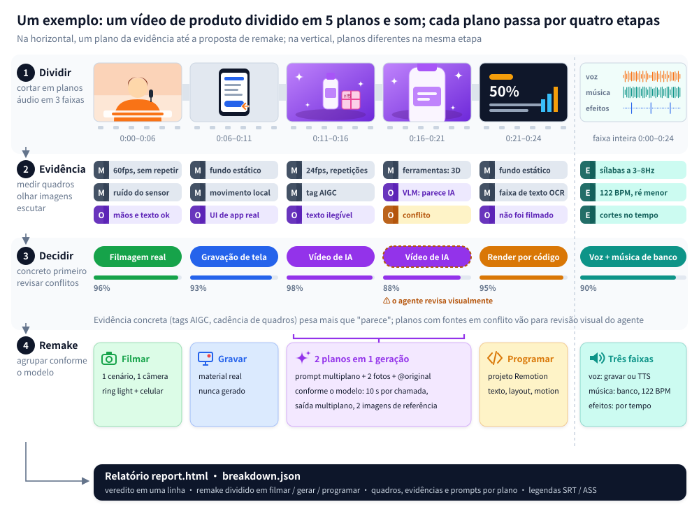

<div align="center">

<picture>
  <source media="(prefers-color-scheme: dark)" srcset="../docs/brand/logo-light.svg">
  
</picture>

Engenharia reversa de qualquer vídeo.

Plano a plano: descobre se foi filmado, gerado por IA ou feito em código, e como refazer.

[Site](https://www.reavideo.ai) | [中文](README_zh.md) | [English](../README.md) | [Русский](README_ru.md) | [日本語](README_ja.md) | [한국어](README_ko.md) | [Español](README_es.md) | Português | [Français](README_fr.md) | [Deutsch](README_de.md)

[](https://github.com/JuneYaooo/rea-video/stargazers)


<a href="https://trendshift.io/repositories/334878" target="_blank"></a>

[](https://www.reavideo.ai) [](https://discord.gg/dZj8D3GqWT) [](https://x.com/yao_june12106)

⭐ *Dá uma estrela no repo para mais gente achar o rea-video!*


Esquerda: anúncio do TikTok gravado no celular. Direita: remake feito com IA, com outro produto. O que o rea-video diz: a esquerda é toda filmada, um cenário só e duas posições de câmera; a direita é toda IA, 8 planos em 3 gerações.

</div>

## Primeiros passos

O rea-video foi pensado para rodar com agentes de IA. No Claude Code, no Codex ou em qualquer agente que rode comandos, é só pedir:

```text
Instala o https://github.com/JuneYaooo/rea-video e depois analisa este vídeo: /path/to/video.mp4
```

O agente instala a CLI, aprende o fluxo e roda tudo. Você só precisa ter ffmpeg e Python 3.10+.

<details><summary>Instalação manual</summary>

```bash
brew install ffmpeg            # sudo apt install ffmpeg
git clone https://github.com/JuneYaooo/rea-video && cd rea-video
bash scripts/install_skill.sh  # instala a CLI (pip, ou pipx / .venv local) e liga o skill → ~/.claude, ~/.codex, ~/.agents
rea-video --help
```

</details>

O que você recebe:

- um resumo em uma linha, tipo "41% vídeo de IA + 59% interface em código, 8 s de gravação de tela real, música de biblioteca a 122 BPM"
- um plano de remake, separando o que filmar, o que gerar e o que programar
- um `report.html` completo, com quadros de cada plano, evidências, prompts, anotações de câmera e iluminação e a análise do áudio

Dá para adicionar um modelo que entenda vídeo — Gemini ou Doubao servem: é só passar o endpoint e a chave para o agente. Com ele, a separação entre real, IA e 3D fica mais precisa, e cada plano ganha um prompt reconstruído. Sem ele, tudo continua funcionando; se o seu agente enxerga imagens, ele mesmo revisa os planos em que ficou na dúvida.

> O relatório sai no idioma em que você pedir (chinês ou inglês). Os relatórios de exemplo abaixo estão em inglês.

## O que dá para analisar

| Tipo de vídeo | Exemplos | O que você recebe |
|---|---|---|
| Filmagem real | Apresentador falando para a câmera, produto em cima da mesa, demo de produto na mão, vlog, tour por loja | Cenários e posições de câmera, enquadramento, movimentos de câmera, iluminação (12 esquemas com lista de equipamentos), correção de cor |
| Vídeo de IA | Texto/imagem para vídeo, minissérie de IA, videoclipe de IA | Evidências, um prompt reconstruído para cada plano, como agrupar em gerações e qual modelo usar |
| Avatar | Um retrato animado por áudio, sincronia labial | Quais planos são de avatar e que retrato e áudio você vai precisar |
| 3D / animação | Vídeos explicativos em Blender / C4D, animação de produto, animação 2D, stop-motion | Se compensa gerar com um modelo de vídeo ou renderizar com código 3D |
| Código / template | Tipografia animada, demos de interface, gráficos, cartões estilo slide | Texto, layout e tempo das animações, prontos para recriar como projeto Remotion |
| Gravação de tela | Tutoriais de software, demos na web | Quais trechos são material real que você vai ter que gravar |
| Misto / edições | Personagens de IA + interface em código + gravação de tela real; filmagem real com edições de IA | Cada plano analisado separadamente e depois montado de novo na linha do tempo original |

Além de como a imagem foi feita, a análise de qualquer vídeo também traz:

- Legendas e textos estilizados: onde começa e termina cada linha (exporta para SRT / ASS), cor, contorno e como o texto entra na tela
- Figurinhas, emoji, picture-in-picture: onde aparecem e quanto tempo ficam na tela
- Edição: onde estão os cortes, qual o ritmo, se batem com a música
- Áudio: voz humana ou de IA, música de IA ou de biblioteca (com o BPM), onde entra cada efeito sonoro
- Material que você vai ter que providenciar: gravações de tela, capturas de tela, fotos de produto

## Exemplos

Os vídeos de exemplo em `docs/cases/videos/` foram recomprimidos para deixar o repo mais leve, e isso apaga as tags de plataforma do TikTok / Douyin. Então, se você rodar com eles, o resultado vai sair diferente dos relatórios abaixo, principalmente sem um modelo de visão. Para reproduzir, use o arquivo original baixado da plataforma.

<table>
<tr>
<td width="50%" valign="top">
<a href="../docs/cases.md#2-混合片ai-人物对话--代码界面--真实录屏"></a><br>
<b>Clipe misto</b> · 19 s · 10 planos<br>
Personagens de IA conversando + interface feita em código + 8 s de gravação de tela real. Os 5 planos de diálogo aparecem intercalados com trechos de interface, mas é o mesmo cenário, então uma geração só dá conta de todos.<br>
<a href="../docs/cases/videos/dual_role.mp4">Vídeo</a> · <a href="../docs/cases/dual_role/report_en.md">Relatório</a>
</td>
<td width="50%" valign="top">
<a href="../docs/cases.md#3-3d-科普片咸鸭蛋为什么会流油"></a><br>
<b>Explicativo em 3D</b> · 67 s · 21 planos<br>
Todo em 3D, narração por IA. Dá para fazer com 10 gerações de vídeo ou pedir para um LLM escrever o código em Blender / Three.js.<br>
<a href="../docs/cases/videos/salted_egg.mp4">Vídeo</a> · <a href="../docs/cases/salted_egg/report_en.md">Relatório</a>
</td>
</tr>
<tr>
<td width="50%" valign="top">
<a href="../docs/cases.md#4-代码-ui-动效产品宣传片"></a><br>
<b>Vídeo promocional de produto</b> · 70 s · 12 planos<br>
83% motion graphics feitos em código, 12% gravação de tela. Não precisa de modelo de vídeo; um projeto Remotion resolve.<br>
<a href="../docs/cases/videos/v10_oiioii_gen_coding_first.mp4">Vídeo</a> · <a href="../docs/cases/v10/report_en.md">Relatório</a>
</td>
<td width="50%" valign="top">
<a href="../docs/cases.md#5-ai-音乐-mv歌是-ai-写的还是曲库的"></a><br>
<b>Videoclipe de IA</b> · 165 s · 86 planos<br>
Acerta que a música foi gerada por IA (foi feita no Suno). O modelo de visão chamou alguns planos de "drama com atores reais"; o agente reparou em caracteres chineses que não existem num pergaminho e marcou esses planos como IA.<br>
<a href="../docs/cases/videos/qing_mv.mp4">Vídeo</a> · <a href="../docs/cases/qing_mv/report_en.md">Relatório</a>
</td>
</tr>
<tr>
<td width="50%" valign="top">
<a href="../docs/cases.md#6-实拍带货沉浸式开箱"></a><br>
<b>Unboxing filmado</b> · 72 s · 29 planos<br>
Tudo filmado: celular num suporte apontado de cima, um tapete, uma posição de câmera, sem narração, som ambiente e trilha de biblioteca. Como a plataforma recomprimiu o vídeo, a ferramenta offline marcou 35% como IA; depois da revisão do agente, ficou em 97% filmagem real.<br>
<a href="../docs/cases/videos/unboxing.mp4">Vídeo</a> · <a href="../docs/cases/unboxing/report_en.md">Relatório</a>
</td>
<td width="50%" valign="top">
<a href="../docs/cases.md#7-ai-与真人混合用自己的出镜视频生成带货片"></a><br>
<b>Híbrido de IA + pessoa real</b> · 58 s · 21 planos<br>
75% real (apresentadora falando para a câmera + tela de celular filmada) e 25% IA: a criadora mandou para o Jimeng um clipe dela mesma falando para a câmera e duas fotos do produto, e gerou um trecho de venda com "pessoa real". A parte de IA foi pega pela marca d'água do Jimeng e pelo texto embaralhado na caixa de presente.<br>
<a href="../docs/cases/videos/ai_daihuo.mp4">Vídeo</a> · <a href="../docs/cases/ai_daihuo/report_en.md">Relatório</a>
</td>
</tr>
</table>

## Remakes

Depois que o rea-video destrincha um vídeo, a receita de remake do [capsule-cinema](https://github.com/JuneYaooo/capsule-cinema) gera uma versão nova: câmera, movimento, ritmo e transições seguem o original, e só muda o que você escolher trocar.
Esses resultados saíram de um MiniMax H3 rodando em servidor próprio: o plano original serve de referência de movimento, e os quadros-chave com os elementos trocados (gpt-image-2) definem o visual.
Abaixo estão três remakes que a OiiOii mostrou nos artigos dela no WeChat. Fizemos duas versões de cada: uma com a mesma troca da OiiOii e outra que troca também o personagem, o cenário e os objetos.
Cada GIF roda quatro versões sincronizadas: original, remake da OiiOii, nosso remake, versão com elementos trocados.

<table>
<tr><td>
<b>Troca de roupa vista de cima</b> · 12 s<br>
Mesma troca: mulher → homem, três looks → roupas masculinas equivalentes. Troca de elementos: uma garota com três trajes Hanfu históricos num escritório chinês; o controle remoto vira um leque redondo.<br>
<br>
<a href="../docs/cases/remake/outfit_compare.mp4">Vídeo comparativo em HD (com áudio)</a> · <a href="../docs/cases/remake/outfit_sheet.jpg">quadros do mesmo instante</a>
</td></tr>
<tr><td>
<b>Animação em papel / aquarela</b> · 30 s<br>
Mesma troca: uma nova garota de massinha como protagonista. Troca de elementos: uma raposa; floresta → recife de coral, nuvens → céu estrelado, pôr do sol → aurora.<br>
<br>
<a href="../docs/cases/remake/paper_compare.mp4">Vídeo comparativo em HD (com áudio)</a> · <a href="../docs/cases/remake/paper_sheet.jpg">quadros do mesmo instante</a>
</td></tr>
<tr><td>
<b>Vídeo de produto na mão</b> · 21 s · 11 planos<br>
Mesma troca: um produto novo, original; adesivo em inglês → legenda em chinês. Troca de elementos: produto rosa, cozinha → mesa de camping, novos ingredientes.<br>
<br>
<a href="../docs/cases/remake/juicer_compare.mp4">Vídeo comparativo em HD (com áudio)</a> · <a href="../docs/cases/remake/juicer_sheet.jpg">quadros do mesmo instante</a>
</td></tr>
</table>

Os vídeos comparativos em HD usam o áudio original. Os originais e as versões da OiiOii foram tirados dos artigos e estão aqui só para comparação.

## Precisão

Precisão ao identificar como cada plano foi feito, ponderada pela duração de cada plano:

| | Conjunto de ajuste (15) | Holdout (16) | Vídeos do WeChat recodificados (10) |
|---|---|---|---|
| Só ferramentas (offline, de graça) | 98.3% | 99.6% / 98.9% | 88.6% |
| + modelo de visão (Gemini) | — | 99.6% / 99.8% | 99.6% |
| + revisão visual pelo agente | — | 99.6% / 99.8% | 100% |

Os dois números do holdout correspondem ao holdout (9 vídeos) e ao holdout2 (7 vídeos).

Com os arquivos originais, as ferramentas sozinhas quase sempre dão conta. Vídeos baixados de plataformas passaram por recompressão, que apaga a evidência de ruído, então é preciso uma checagem visual para voltar a passar dos 99%.

A detecção de material real fica entre 97% e 99%, e os limites dos planos saem todos certos. Os números e como reproduzir: [eval/RESULTS.md](../eval/RESULTS.md).

## Como funciona



1. Dividir: corta o vídeo em planos e separa o áudio em voz, música e efeitos.
2. Juntar evidências: mede os quadros (cadência de quadros, ruído do sensor, se a imagem inteira se desloca como um único plano, tags de AIGC nos metadados); olha as imagens (mãos, texto, física); ouve o áudio (BPM, tom, se é canto ou fala).
3. Decidir: evidência concreta, como tag de AIGC e cadência de quadros, vale mais do que "parece que". Quando há conflito, ele fica sinalizado para o agente revisar visualmente.
4. Planejar o remake: agrupa os planos conforme o que o modelo de vídeo escolhido consegue fazer de verdade, como duração máxima do clipe, suporte a múltiplos planos e quantas imagens de referência ele aceita.

## Star History

[](https://star-history.com/#JuneYaooo/rea-video&Date)

## Perguntas frequentes

<details>
<summary>Qual a diferença para ferramentas de remake em um clique, tipo o Hypit?</summary>

O [Hypit](https://github.com/hypit-ai/hypit) pega um vídeo de referência e faz um novo: o agente lê grades de quadros para entender o original, gera as imagens com os modelos que suporta (Seedance, PixVerse, MiniMax, Wan e outros) e renderiza legendas e motion graphics em HTML.

Ele não se pergunta como o original foi feito. Um vídeo filmado passa pelo mesmo pipeline; ele não vai te dizer quantas câmeras foram usadas nem como foi a iluminação. O tipo de vídeo de IA que ele consegue imitar depende dos modelos que ele tem: nada de Kling nem Veo, nenhum caminho dedicado para avatar ou 3D, e nada de música de IA (você traz a sua). Ele vai melhor em vídeos de apresentador, podcast e entrevista que seguem roteiro, e pior em edições guiadas pela música, motion graphics de produto e curtas com cara de cinema.

O rea-video não renderiza vídeo. Ele descobre, plano a plano, se aquilo foi filmado, gerado por IA ou feito em código, e aí entrega um plano de filmagem, prompts ou uma abordagem em código para cada um. Se você quer uma imitação rápida, o Hypit é mais rápido. Se quer entender como o original foi feito e refazer gastando pouco, use o rea-video. Dá para usar os dois juntos sem problema.

</details>

<details>
<summary>Preciso de um modelo que entenda vídeo? Quanto custa?</summary>

Não. O modo só com ferramentas roda offline, é de graça e já é preciso em arquivos originais. Para vídeos baixados de plataformas, que vêm recomprimidos, adicione um modelo que entenda vídeo (Gemini ou Doubao servem) ou use um agente que enxergue imagens; aí você paga o que esse serviço cobrar. A geração automática de vídeo (capsule-cinema) roda antes uma simulação gratuita e só chama os modelos pagos depois que você confirmar.

</details>

<details>
<summary>Ele refaz o vídeo inteiro sozinho?</summary>

Em parte. Com o [capsule-cinema](https://github.com/JuneYaooo/capsule-cinema) instalado, os planos de IA são gerados e encaixados de volta na linha do tempo original automaticamente. Os planos reais você mesmo filma, seguindo o plano de filmagem; os planos em código o agente escreve como um projeto Remotion. Veja [docs/replicate.md](../docs/replicate.md).

</details>

<details>
<summary>Posso só repostar o vídeo de outra pessoa?</summary>

Não. O rea-video serve para aprender a estrutura, o ritmo e as técnicas de um vídeo e depois refazer com material que você tem direito de usar. Não reaproveite imagens, músicas, personagens nem a imagem de outras pessoas. Na hora de publicar, siga as regras da plataforma e as exigências locais de identificação de conteúdo gerado por IA.

</details>

## Documentação

- [docs/what-it-detects.md](../docs/what-it-detects.md): tudo o que ele detecta (10 tipos visuais, câmera, iluminação, cor, áudio)
- [docs/replicate.md](../docs/replicate.md): como refazer a partir do relatório
- [docs/cases.md](../docs/cases.md): detalhes de cada caso
- [docs/decompose.md](../docs/decompose.md): regras de detecção
- [docs/cli.md](../docs/cli.md): como usar a CLI e a integração com o capsule-cinema
- [rea_video/capabilities/](../rea_video/capabilities/README.md): tabelas de capacidades dos modelos de vídeo / imagem / áudio, usadas para escolher os modelos no plano de remake
- [eval/RESULTS.md](../eval/RESULTS.md): resultados da avaliação

Por enquanto, a documentação está só em chinês.

## Comunidade

Dúvidas, análises e ideias de remake: [GitHub Discussions](https://github.com/JuneYaooo/rea-video/discussions). A gente também está no [Discord](https://discord.gg/dZj8D3GqWT). Quem fala chinês também acha a gente no [linux.do](https://linux.do/).

Quer que a gente analise um vídeo? Abra uma [issue de pedido](https://github.com/JuneYaooo/rea-video/issues/new?template=request_breakdown.yml) com o link e a gente publica o resultado como um caso.

## Créditos

Inspirado no [REA (Reverse Engineer Anything)](https://github.com/morluto/rea): partir do que se vê para chegar em como foi feito, sustentar cada afirmação com evidência e verificar medindo.
