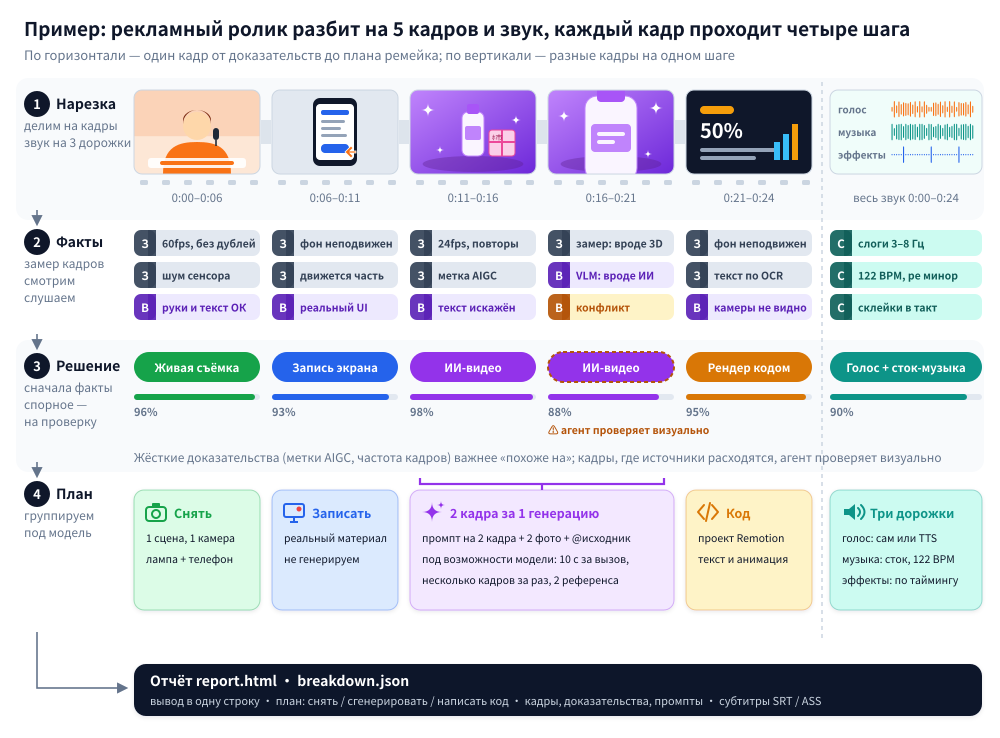

<div align="center">

<picture>
  <source media="(prefers-color-scheme: dark)" srcset="../docs/brand/logo-light.svg">
  
</picture>

Разбираем любое видео по косточкам.

Для каждого кадра: снят он на камеру, сгенерирован ИИ или собран кодом — и как сделать такой же.

[Сайт](https://www.reavideo.ai) | [中文](README_zh.md) | [English](../README.md) | Русский | [日本語](README_ja.md) | [한국어](README_ko.md) | [Español](README_es.md) | [Português](README_pt.md) | [Français](README_fr.md) | [Deutsch](README_de.md)

[](https://github.com/JuneYaooo/rea-video/stargazers)


<a href="https://trendshift.io/repositories/334878" target="_blank"></a>

[](https://www.reavideo.ai) [](https://discord.gg/dZj8D3GqWT) [](https://x.com/yao_june12106)

⭐ *Поставьте звезду — так о rea-video узнает больше людей.*


Слева — реклама из TikTok, снятая на телефон. Справа — ИИ-ремейк с другим товаром. Вердикт rea-video: левое видео целиком снято вживую, одна локация, две точки съёмки; правое целиком ИИ — 8 кадров за 3 генерации.

</div>

## Быстрый старт

rea-video рассчитан на работу через ИИ-агента. В Claude Code, Codex или любом другом агенте, который умеет запускать команды, напишите:

```text
Установи https://github.com/JuneYaooo/rea-video и разбери это видео: /path/to/video.mp4
```

Агент сам поставит CLI, разберётся, как с ним работать, и всё прогонит. Понадобятся ffmpeg и Python 3.10+.

<details><summary>Установка вручную</summary>

```bash
brew install ffmpeg            # sudo apt install ffmpeg
git clone https://github.com/JuneYaooo/rea-video && cd rea-video
bash scripts/install_skill.sh  # ставит CLI (pip, иначе pipx / локальный .venv) и подключает skill → ~/.claude, ~/.codex, ~/.agents
rea-video --help
```

</details>

На выходе:

- сводка в одну строку, например: «41% ИИ-видео + 59% интерфейса на коде, 8 с настоящей записи экрана, библиотечная музыка, 122 BPM»
- план ремейка: что снять, что сгенерировать, что написать кодом
- подробный `report.html`: кадры по каждому плану, доказательства, промпты, заметки по камере и свету, разбор звука

Если подключить модель, которая понимает видео (подойдут Gemini или Doubao — просто дайте агенту endpoint и ключ), rea-video точнее отличает живую съёмку от ИИ и 3D и пишет восстановленный промпт для каждого кадра. Без модели тоже всё работает: если агент умеет смотреть картинки, спорные кадры он проверит сам.

> Отчёт пишется на том языке, на котором вы спросили (китайский или английский). Примеры отчётов ниже — на английском.

## Что можно разобрать

| Тип видео | Примеры | Что вы получите |
|---|---|---|
| Живая съёмка | «Говорящая голова», предметная съёмка на столе, демонстрация товара в руках, влог, обзор магазина | Локации и точки съёмки, крупность, движение камеры, свет (12 схем со списком оборудования), цветокоррекция |
| ИИ-видео | Text/image-to-video, ИИ-мини-сериалы, ИИ-клипы | Доказательства, восстановленный промпт для каждого кадра, как разбить кадры на генерации и какую модель взять |
| Аватар | Портрет, анимированный по аудио, липсинк | Какие кадры сделаны аватаром, какой портрет и какое аудио нужны |
| 3D / анимация | Научпоп на Blender / C4D, анимация товара, 2D-анимация, стоп-моушн | Чем делать: генерировать видеомоделью или рендерить из 3D-кода |
| Код / шаблон | Кинетическая типографика, демо интерфейсов, графики, карточки в стиле слайдов | Текст, раскладка и тайминги анимации — можно сразу собирать как проект Remotion |
| Запись экрана | Уроки по программам, демо сайтов | Какие фрагменты — реальный материал, который придётся записать самому |
| Смешанное / монтаж | ИИ-персонажи + интерфейс на коде + настоящая запись экрана; живая съёмка с ИИ-правками | Каждый кадр оценивается отдельно, потом всё собирается обратно по исходному таймлайну |

Кроме того, как сделана картинка, в каждом видео разбираются:

- Субтитры и оформленный текст: начало и конец каждой строки (экспорт в SRT / ASS), цвет, обводка и то, как текст появляется
- Стикеры, эмодзи, «картинка в картинке»: где стоят и сколько висят на экране
- Монтаж: где склейки, какой темп, попадают ли в бит
- Звук: живой голос или ИИ, ИИ-музыка или библиотечная и какой у неё BPM, где стоит каждый звуковой эффект
- Что придётся подготовить самому: записи экрана, скриншоты, фото товара

## Примеры

Видео-примеры в `docs/cases/videos/` пережаты, чтобы репозиторий не раздувался, и при этом с них слетели метки платформ TikTok / Douyin. Поэтому если прогнать их самому, результат будет отличаться от отчётов ниже, особенно без модели, которая видит картинку. Чтобы воспроизвести, берите оригинальный файл, скачанный с платформы.

<table>
<tr>
<td width="50%" valign="top">
<a href="../docs/cases.md#2-混合片ai-人物对话--代码界面--真实录屏"></a><br>
<b>Смешанный ролик</b> · 19 с · 10 кадров<br>
Диалог ИИ-персонажей + интерфейс на коде + 8 с настоящей записи экрана. 5 диалоговых кадров перемежаются вставками интерфейса, но локация у них одна, так что хватает одной генерации.<br>
<a href="../docs/cases/videos/dual_role.mp4">Видео</a> · <a href="../docs/cases/dual_role/report_en.md">Отчёт</a>
</td>
<td width="50%" valign="top">
<a href="../docs/cases.md#3-3d-科普片咸鸭蛋为什么会流油"></a><br>
<b>3D-научпоп</b> · 67 с · 21 кадр<br>
Целиком 3D, озвучка ИИ. Можно собрать из 10 видеогенераций или попросить LLM написать код на Blender / Three.js.<br>
<a href="../docs/cases/videos/salted_egg.mp4">Видео</a> · <a href="../docs/cases/salted_egg/report_en.md">Отчёт</a>
</td>
</tr>
<tr>
<td width="50%" valign="top">
<a href="../docs/cases.md#4-代码-ui-动效产品宣传片"></a><br>
<b>Промо продукта</b> · 70 с · 12 кадров<br>
83% — моушн-графика на коде, 12% — запись экрана. Видеомодель не нужна, всё делается одним проектом Remotion.<br>
<a href="../docs/cases/videos/v10_oiioii_gen_coding_first.mp4">Видео</a> · <a href="../docs/cases/v10/report_en.md">Отчёт</a>
</td>
<td width="50%" valign="top">
<a href="../docs/cases.md#5-ai-音乐-mv歌是-ai-写的还是曲库的"></a><br>
<b>ИИ-клип</b> · 165 с · 86 кадров<br>
Песня правильно определена как ИИ (её сделали в Suno). Визуальная модель записала часть кадров в «игровое кино», но агент заметил на свитке несуществующие иероглифы и отнёс эти кадры к ИИ.<br>
<a href="../docs/cases/videos/qing_mv.mp4">Видео</a> · <a href="../docs/cases/qing_mv/report_en.md">Отчёт</a>
</td>
</tr>
<tr>
<td width="50%" valign="top">
<a href="../docs/cases.md#6-实拍带货沉浸式开箱"></a><br>
<b>Распаковка, живая съёмка</b> · 72 с · 29 кадров<br>
Всё снято вживую: телефон на штативе сверху, один коврик, одна точка съёмки, без закадрового голоса — только звук комнаты и библиотечная фоновая музыка. Из-за перекодирования на платформе офлайн-инструмент принял 35% видео за ИИ; после проверки агентом доля живой съёмки — 97%.<br>
<a href="../docs/cases/videos/unboxing.mp4">Видео</a> · <a href="../docs/cases/unboxing/report_en.md">Отчёт</a>
</td>
<td width="50%" valign="top">
<a href="../docs/cases.md#7-ai-与真人混合用自己的出镜视频生成带货片"></a><br>
<b>Гибрид: ИИ и живой человек</b> · 58 с · 21 кадр<br>
75% — живая съёмка («говорящая голова» + съёмка экрана телефона), 25% — ИИ: автор загрузила в Jimeng свой ролик, где она в кадре, и два фото товара и сгенерировала «живой» фрагмент с товаром. ИИ-часть выдали водяной знак Jimeng и кривой текст на подарочной коробке.<br>
<a href="../docs/cases/videos/ai_daihuo.mp4">Видео</a> · <a href="../docs/cases/ai_daihuo/report_en.md">Отчёт</a>
</td>
</tr>
</table>

## Ремейки

Когда rea-video разобрал видео, рецепт ремейка из [capsule-cinema](https://github.com/JuneYaooo/capsule-cinema) генерирует новую версию: камера, движение, темп и переходы — как в оригинале, меняются только те элементы, которые выберете вы.
Всё это сгенерировано на MiniMax H3, развёрнутой у нас: исходный кадр служит референсом движения, а внешний вид задают ключевые кадры с заменёнными элементами (gpt-image-2).
Ниже — три ремейка, которые OiiOii показывала в своих статьях в WeChat. Для каждого мы сделали две версии: с той же заменой, что у OiiOii, и ещё одну, где заменены также герой, обстановка и реквизит.
В каждом GIF синхронно идут четыре версии: оригинал, ремейк OiiOii, наш ремейк и версия с заменой элементов.

<table>
<tr><td>
<b>Переодевание, вид сверху</b> · 12 с<br>
Та же замена: женщина → мужчина, три наряда → подходящая мужская одежда. Замена элементов: девушка в трёх исторических ханьфу в китайском кабинете, пульт превращается в круглый веер.<br>
<br>
<a href="../docs/cases/remake/outfit_compare.mp4">Видео для сравнения в HD (со звуком)</a> · <a href="../docs/cases/remake/outfit_sheet.jpg">кадры в один и тот же момент</a>
</td></tr>
<tr><td>
<b>Анимация в стиле бумажной аппликации / акварели</b> · 30 с<br>
Та же замена: главная героиня — новая пластилиновая девочка. Замена элементов: лиса; лес → коралловый риф, облака → звёздное небо, закат → северное сияние.<br>
<br>
<a href="../docs/cases/remake/paper_compare.mp4">Видео для сравнения в HD (со звуком)</a> · <a href="../docs/cases/remake/paper_sheet.jpg">кадры в один и тот же момент</a>
</td></tr>
<tr><td>
<b>Видео с товаром в руках</b> · 21 с · 11 кадров<br>
Та же замена: новый оригинальный товар, английский стикер → китайская подпись. Замена элементов: розовый товар, кухня → походный столик, другие ингредиенты.<br>
<br>
<a href="../docs/cases/remake/juicer_compare.mp4">Видео для сравнения в HD (со звуком)</a> · <a href="../docs/cases/remake/juicer_sheet.jpg">кадры в один и тот же момент</a>
</td></tr>
</table>

В HD-видео для сравнения звук оригинальный. Оригиналы и версии OiiOii взяты из статей и показаны только для сравнения.

## Точность

Насколько точно определяется, как сделан кадр (с весом по длительности кадров):

| | Набор для настройки (15) | Отложенная выборка (16) | Перекодированные видео из WeChat (10) |
|---|---|---|---|
| Только инструменты (офлайн, бесплатно) | 98.3% | 99.6% / 98.9% | 88.6% |
| + визуальная модель (Gemini) | — | 99.6% / 99.8% | 99.6% |
| + визуальная проверка агентом | — | 99.6% / 99.8% | 100% |

Для отложенной выборки два числа: holdout (9 видео) и holdout2 (7 видео).

На исходных файлах обычно хватает одних инструментов. Видео, скачанные с платформ, пережаты, и шумовые признаки в них стёрты — чтобы снова подняться выше 99%, нужна визуальная проверка.

Реальные материалы находятся с точностью 97–99%, границы кадров определяются без ошибок. Цифры и как их воспроизвести — в [eval/RESULTS.md](../eval/RESULTS.md).

## Как это устроено



1. Нарезка: видео делится на кадры, звук — на голос, музыку и эффекты.
2. Сбор доказательств: замеры по кадрам (частота смены кадров, шум сенсора, двигается ли вся картинка как одна плоскость, метки AIGC в метаданных); анализ изображения (руки, текст, физика); анализ звука (BPM, тональность, пение или речь).
3. Решение: жёсткие улики вроде меток AIGC и частоты кадров весят больше, чем «похоже на». Если признаки противоречат друг другу, кадр помечается, и агент проверяет его глазами.
4. План ремейка: кадры группируются под реальные возможности целевой видеомодели — максимальную длину клипа, поддержку нескольких планов, число референсных изображений, которое она принимает.

## Star History

[](https://star-history.com/#JuneYaooo/rea-video&Date)

## FAQ

<details>
<summary>Чем это отличается от ремейка в один клик вроде Hypit?</summary>

[Hypit](https://github.com/hypit-ai/hypit) берёт видео-референс и делает по нему новое: агент смотрит сетки кадров, чтобы понять оригинал, генерирует материал поддерживаемыми моделями (Seedance, PixVerse, MiniMax, Wan и другими), а субтитры и моушн-графику рендерит в HTML.

Как был сделан оригинал, он не выясняет. Живая съёмка идёт через тот же конвейер — сколько было камер и как стоял свет, он не скажет. Какое ИИ-видео он сможет повторить, зависит от доступных ему моделей: Kling и Veo нет, отдельного пути для аватаров и 3D нет, ИИ-музыки тоже нет — её придётся принести свою. Лучше всего у него получаются «говорящие головы», подкасты и интервью по сценарию, хуже — монтаж под музыку, моушн-графика для продуктов и кинематографичные короткометражки.

rea-video видео не рендерит. Он для каждого кадра определяет, снят тот, сгенерирован ИИ или собран кодом, и даёт по нему план съёмки, промпты или подход на коде. Если нужно быстро сделать что-то похожее, Hypit быстрее. Если нужно понять, как сделан оригинал, и недорого его переснять — берите rea-video. Вместе они тоже нормально работают.

</details>

<details>
<summary>Нужна ли модель, которая понимает видео? Сколько это стоит?</summary>

Нет. Режим «только инструменты» работает офлайн, бесплатно и на исходных файлах уже точный. Для пережатых видео с платформ подключите модель, которая понимает видео (подойдут Gemini или Doubao), или возьмите агента, который видит картинки; платите по тарифам этого сервиса. Автоматическая генерация видео (capsule-cinema) сначала делает бесплатный пробный прогон и вызывает платные модели только после вашего подтверждения.

</details>

<details>
<summary>Может ли он сам переснять всё видео?</summary>

Частично. Если установлен [capsule-cinema](https://github.com/JuneYaooo/capsule-cinema), ИИ-кадры генерируются и сами встают обратно на исходный таймлайн. Живые кадры вы снимаете по плану съёмки, а кадры на коде агент пишет как проект Remotion. Подробнее — в [docs/replicate.md](../docs/replicate.md).

</details>

<details>
<summary>Можно просто перезалить чужое видео?</summary>

Нет. rea-video нужен, чтобы разобраться в структуре, темпе и приёмах ролика, а потом переснять его на материале, на который у вас есть права. Не используйте чужие кадры, музыку, персонажей и внешность. При публикации соблюдайте правила платформ и местные требования к маркировке ИИ-контента.

</details>

## Документация

- [docs/what-it-detects.md](../docs/what-it-detects.md): всё, что он распознаёт (10 визуальных типов, камера, свет, цветокоррекция, звук)
- [docs/replicate.md](../docs/replicate.md): как делать ремейк по отчёту
- [docs/cases.md](../docs/cases.md): подробности по примерам
- [docs/decompose.md](../docs/decompose.md): правила определения
- [docs/cli.md](../docs/cli.md): CLI и интеграция с capsule-cinema
- [rea_video/capabilities/](../rea_video/capabilities/README.md): таблицы возможностей моделей для видео, изображений и аудио — по ним подбираются модели для плана ремейка
- [eval/RESULTS.md](../eval/RESULTS.md): результаты оценки

Документация пока только на китайском.

## Сообщество

Вопросы, разборы и идеи для ремейков — в [GitHub Discussions](https://github.com/JuneYaooo/rea-video/discussions). Ещё мы есть в [Discord](https://discord.gg/dZj8D3GqWT). Китайскоязычные пользователи могут найти нас и на [linux.do](https://linux.do/).

Хотите, чтобы мы разобрали видео? Откройте [issue с запросом](https://github.com/JuneYaooo/rea-video/issues/new?template=request_breakdown.yml) со ссылкой — результат опубликуем как пример.

## Благодарности

Вдохновлено [REA (Reverse Engineer Anything)](https://github.com/morluto/rea): идти от того, что видно, к тому, как это сделано, подкреплять каждое утверждение доказательствами и проверять замерами.
